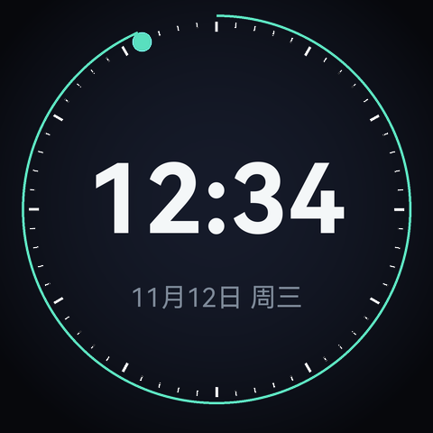

# Mochi · 桌面表情摆件

一块 **ESP32-S3-LCD-2.8C**（480×480 圆屏 + 六轴 + RTC），做成桌面上会「活着」的小东西：

- 默认是一个会眨眼、会跟着你倾斜看、被摸会笑的表情；
- 摇一摇切到下一个应用（时钟、以后的天气/番茄钟…）；
- 应用可以从网页安装，不用重新刷固件（M2）。


| 时钟 |
|---|
|  |

> 桌宠是 53 帧 24fps 的序列（吃米饭），经 `tools/pack_clip.py` 压成 `.mjp` 放 TF 卡；
> 时钟那张是 `tools/preview.py` 渲染的设计稿。

---

## 当前状态

| 阶段 | 内容 | 状态 |
|---|---|---|
| **M1 内核** | 渲染器 / 桌宠动画 / 时钟 / 摇一摇 / 轻敲 / 翻转息屏 / RTC | 已上机：桌宠从 TF 卡播放，24fps（素材原速） |
| **M2 插件** | Lua 运行时 / 沙箱 / `ui` + `time` API | 已上机：内置 demo 跑通 |
| **M2 后台** | WiFi AP+STA、网页管理、插件安装、NTP | 已上机：自检跑通「上传→安装→列表」 |
| M3 生态 | 插件市场、更多字号、天气/番茄钟示例 | 待做 |

完整设计见 [docs/architecture.md](docs/architecture.md)，实机记录见 [docs/verification.md](docs/verification.md)。

---

## 插件（Lua）

固件内置 Lua 5.4（32 位数值模式），插件是卡上的一个目录：

```
/sdcard/plugins/<id>/main.lua
```

```lua
local t = 0
function on_draw(dt)          -- 每帧调用
  t = t + dt
  ui.clear(0x0b0d12)
  ui.circle(240, 240, 110 + 18 * math.sin(t * 2), 0x2aa887)
  ui.text(string.format("%d", math.floor(t) % 100), 240, 240, 106, 0xffffff)
end
```

| API | 说明 |
|---|---|
| `ui.clear(color)` | 整屏填充 |
| `ui.rect(x, y, w, h, color)` | 左上角坐标 |
| `ui.circle(cx, cy, r, color)` / `ui.ring(cx, cy, r, thick, color)` | |
| `ui.line(x0, y0, x1, y1, thick, color)` | |
| `ui.text(s, x, y, size, color)` | 居中；`size` 目前两档：<60 用 29px，≥60 用 106px（只含数字和冒号） |
| `time.now()` | 返回 `{year, month, day, hour, min, sec, wday}` |
| `app.get(key)` | 读插件设置（网页「插件详情」里填的值） |
| `http.get(url, cb)` | 异步 GET；回调 `cb(status, body)` 在绘制线程里执行 |
| `json.decode(str)` | JSON → Lua table |
| `log(...)` | 打到串口 |

颜色是 `0xRRGGBB`。可选 `on_start()` 在加载后调用一次。

### 插件设置

manifest 里用 `settings` 描述表单，网页会自动生成控件：

```json
"settings": [
  {"key": "lat", "label": "纬度", "type": "number", "default": "22.54"},
  {"key": "unit", "label": "单位", "type": "select", "options": ["c", "f"], "default": "c"}
]
```

`type` 支持 `text` / `number` / `select`。值存在 `/sdcard/plugins/<id>/settings.json`，
插件里用 `app.get("lat")` 读；网页点插件名字就能改，保存后插件会自动重载。

### 示例插件：时钟

三种样式，在插件详情页切换：

| 样式 | 样子 |
|---|---|
| `cute` | 奶油色背景、小太阳、大号时间、日期药丸（含「周几」）、秒进度环 |
| `tech` | 深色背景、60 格刻度、秒弧 + 游标、`2026.11.12 THU` |
| `minimal` | 只有时针/分针/秒针和 12 个刻度，背景色、指针色、秒针色都可调 |

`minimal` 的三个颜色用 `type: "color"` 的色板选，存成 `#RRGGBB`。

### 示例插件：天气

实时天气 + 未来三天，中文显示，温度后面跟 ℃，图标是 **meteocons 的原始动画**：

```
       深圳              [太阳转动的图标]
                         13℃
                         多云
     ────────────────────────
     11/13     11/14     11/15    ← 日期
      [雨]      [云]      [晴]     ← 动画图标
      20℃       22℃       19℃     ← 高温，橙色
      11℃       12℃       10℃     ← 低温，蓝色
```

地名取插件设置里的「地名」字段；字段为空时默认显示「深圳」。
只有内置字体里的字能显示（ASCII + 约 40 个常用城市名），其它字会被跳过。

用的是 **Open-Meteo**：免费、**不用注册、不需要 API key**、HTTPS JSON。

**素材全部在 TF 卡上**，不占闪存：

- `/sdcard/icons.bin` —— 15 个图标 × 8 帧（96px）+ 64px 静态小图，RGB565 + A8
- `/sdcard/plugins/weather/data.json` —— 上次拉到的天气 JSON + 时间戳

拉取策略：进屏先用缓存渲染，超过 10 分钟才重新请求；请求失败也保留旧数据不报错
（只有一条数据都没有时才显示「等待网络 / 加载中 / 网络错误」）。

**沙箱**：堆在 PSRAM、上限 192KB；单帧 12 万条指令预算；只开 base/string/table/math/utf8/coroutine，没有 `io`/`os`/`package`/`debug`，插件拿不到文件和系统调用。

应用顺序：网络 → 桌宠 → **每个已启用插件一屏**，摇一摇或按 BOOT 轮换。
网络和桌宠也是「内置插件」：有 manifest、有详情页、能被停用，只是代码编在固件里。
网页上每行右边的勾就是启用开关，全部停用时保底显示网络屏。

**网络屏**：没连 WiFi 时开机停在这一屏，提示热点名/密码和 `http://192.168.4.1`；
连上家里 WiFi 后显示路由器分配的 IP（局域网里用这个地址访问），展示几秒后自动进桌宠。

## 桌宠 / DeepSeek 余额

桌宠按余额状态换动画，屏幕底部有三块信息：

```
        [工作动画 / 吃饭动画 / 睡觉动画]

  ( ￥5.69 )        ( 今日 0.12 )        ← 左右两个奶油色气泡
                [ 谷 ]                  ← 正下方峰谷徽章
```

**动画状态机**（每 5 分钟查一次余额）：

| 条件 | 动画 |
|---|---|
| 余额在下降（最近 5 分钟内掉过） | `work.mjp` 打字工作 |
| 5 分钟没变化 | `pet.mjp` 吃饭 |
| 30 分钟没变化 | `sleep.mjp` 睡觉 |

余额变化时间存在 NVS，重启后接着算。

**数据来源**：

- **余额**：`GET https://api.deepseek.com/user/balance`，`Authorization: Bearer <API_KEY>`，
  在网页「桌宠 → 详情」填 key，不需要账号登录
- **今日消耗**：官方没有用量接口，用「当天首次读到的余额 − 当前余额」估算，基线存 NVS
- **峰谷**：按官方定价页的时段算。峰时 = UTC 01:00–04:00 与 06:00–10:00、周一至周五，
  换成北京时间是 **09:00–12:00 和 14:00–18:00**；其余时段（含周末、法定节假日）都是谷时。
  显示 `谷` 用薄荷绿、`峰` 用琥珀色。**法定节假日没有内置日历**，节假日当天会按工作日算。

没填 key 显示 `SET API KEY`，key 无效显示 `KEY INVALID`。key 明文存在
`/sdcard/plugins/pet/settings.json`，不编进固件。

**素材怎么进卡**：电脑不能直接写卡，所以三段动画打包成 `assets.bin` 烧到 assets 分区，
开机时 `assets_sync()` 只把「大小或内容不一致」的文件写到 `/sdcard/`。换素材：

```bash
python tools/pack_dir.py --dir <帧目录> --out firmware/assets/work.mjp --fps 24
python tools/pack_assets.py --out firmware/assets/assets.bin \
    --add pet.mjp=firmware/assets/pet.mjp \
    --add work.mjp=firmware/assets/work.mjp \
    --add sleep.mjp=firmware/assets/sleep.mjp
```

---

## 网页后台

设备永远开一个热点：

- SSID **`Mochi-XXXX`**（后四位是 MAC），密码 **`mochi1234`**
- 浏览器打开 **http://192.168.4.1**

| 功能 | 说明 |
|---|---|
| 状态 | 当前应用、帧率、内存、热点、IP |
| 插件 | 列表、启用、删除、**详情页**（manifest 信息 + 按 schema 生成的设置表单） |
| 安装 | 多选 `manifest.json` + `main.lua` 上传，装到 `/sdcard/plugins/<id>/`；或装内置示例 |
| 控制 | 上一个 / 下一个 / 轻敲 / 摇一摇（远程切屏，调试用） |
| WiFi | 扫描附近 SSID（带信号强度）、点击填入、连接状态与失败原因、保存后自动对时 |
| 固件 | 上传 `.bin` OTA 升级 |

连上家里 WiFi 后，设备在局域网里也能访问：状态卡会同时显示「热点地址」和「局域网地址」，
屏幕上也会显示路由器分配的 IP。

REST 接口：

```
GET    /api/status
GET    /api/scan                                扫描附近 WiFi
GET    /api/apps
GET    /api/app?id=<plugin>                     manifest + 当前设置
POST   /api/app/settings?id=<plugin>            body 是扁平 JSON
POST   /api/app/enable?id=<plugin>&on=0|1       启用 / 停用
GET    /api/builtin                             内置示例列表
POST   /api/builtin/install?id=<plugin>         把内置示例写到卡上
POST   /api/upload?id=<plugin>&file=<name>     原始 body 写文件
POST   /api/install?id=<plugin>                校验 manifest + main.lua
POST   /api/active?id=<plugin>
DELETE /api/app?id=<plugin>
POST   /api/gesture?event=next|prev|tap|shake
POST   /api/wifi?ssid=..&pass=..
POST   /api/ota                                原始固件
```

> 插件不打包成 zip：浏览器直接把选中的文件逐个 POST 上来，设备端不引入解压库。

---

## 素材放 TF 卡

桌宠是 53 帧 480×480 的 JPEG 序列（`pet.mjp`，1.14MB，24fps / 2.21 秒循环），运行时从 TF 卡加载：

- 文件位置：`/sdcard/pet.mjp`（卡根目录）
- 后台任务环形预读 **576KB**（12 帧），边读边解，不再整段缓存
- 卡上没有、而 flash 的 `assets` 分区还有旧副本时，会自动拷到卡上（一次性）
- 两个都没有 → 屏幕显示 `NO ASSET`

换素材只要替换卡上这个文件；`.mjp` 用 `tools/pack_clip.py` 从 PNG 序列生成
（优先用包里的 `frames_rgb`，没有就把 `frames_alpha` 合成到黑底；当前是 `--quality 82`）。

> 实测 40MHz 下单卡顺序读 1.23MB/s，播放消耗约 0.5MB/s，预读余量很大。
> 加载后 PSRAM 还剩 ~5.6MB，M2 的插件可以放开用。

---

## 为什么不是 GIF

表情是**代码画出来的**，不是预制动画：

- 眨眼间隔随机、偶尔连眨；
- 眼睛跟着板子的倾斜移动（QMI8658），还会自己瞟一眼；
- 单击会眯眼笑 + 弹一下，双击会转晕冒星星；
- 呼吸缩放、体块渐变全部每帧计算。

这样 480×480 只占几十 KB 代码，而且切换状态不会卡；换成 GIF/视频，
每个状态都要几百 KB，还没法随机。

---

## 硬件

ESP32-S3-LCD-2.8C（ESP32-S3R8，16MB Flash / 8MB Octal PSRAM）：

- 2.8 寸 480×480 圆屏，ST7701S + RGB565 并口
- QMI8658 六轴、PCF85063 RTC、TCA9554 IO 扩展、蜂鸣器
- USB-C 直接烧录（板载 CH343P / USB-Serial-JTAG）

引脚定义在 `firmware/main/board.h`，和微雪官方示例一致。

---

## 编译 / 烧录

环境：ESP-IDF **v5.5.2**，目标 `esp32s3`。

```powershell
$env:IDF_PATH='D:\esp\esp-idf'
$env:IDF_TOOLS_PATH='D:\esp\.espressif'
. D:\esp\esp-idf\export.ps1

cd firmware
idf.py build
idf.py -p COM10 flash monitor
```

串口日志正常应该看到：

```
I (xxx) io: TCA9554 ready, input=0x00
I (xxx) rtc: RTC 2026-11-12 13:40:00
I (xxx) lcd: frame buffers in psram: 3 x 450 KB
I (xxx) imu: found QMI8658 at 0x6B, WHO_AM_I=0x05
I (xxx) mochi: ========== Mochi 0.1 ==========
```

---

## 交互

| 动作 | 效果 |
|---|---|
| 摇一摇 | 下一个应用（表情 ↔ 时钟） |
| 单击（敲桌面/轻碰板子） | 表情：眯眼笑 + 弹一下 |
| 双击 | 表情：转晕、冒星星 |
| 屏幕朝下放 | 息屏 |
| 翻回来 / 摇一下 | 亮屏 |
| BOOT 键短按 | 下一个应用 |

阈值在 `imu.c` 顶部，实机按手感调。

---

## 目录

```
mochi/
├─ firmware/                  ESP-IDF 工程
│  ├─ main/
│  │  ├─ gfx.c                SDF 抗锯齿渲染器（480×480 RGB565）
│  │  ├─ app_face.c           表情（程序化绘制）
│  │  ├─ app_clock.c          时钟（刻度环 + 秒游标 + 大字）
│  │  ├─ apps.c               应用管理与淡入淡出
│  │  ├─ imu.c                QMI8658 + 手势识别
│  │  ├─ rtc.c                PCF85063 + 编译时刻兜底
│  │  ├─ lcd.c / io.c         屏幕与 IO 扩展（复用自已验证的驱动）
│  │  └─ fonts.c              字体图集（自动生成）
│  ├─ partitions.csv
│  └─ sdkconfig.defaults
├─ tools/
│  ├─ preview.py              视觉预览（设计用，不参与构建）
│  └─ gen_font.py             TTF → 固件字体
└─ docs/architecture.md       平台/插件/网页设计
```

---

## 已知限制（M1）

- 外发光暂时关闭（逐像素半透明 45ms/帧），后续用预渲染纹理补回。
- 整屏重绘受 PSRAM 带宽限制（~30MB/s，450KB/帧），当前 ~35fps，细节见 [docs/verification.md](docs/verification.md)。
- 没有联网：时间来自 RTC 或编译时刻；NTP/网页配网在 M2。
- 中文字符集只有 138 个（日期、星期和少量提示语），M2 再扩。
- `tools/preview.py` 是独立实现（Pillow），只用来定视觉；像素级以 `gfx.c` 为准。
