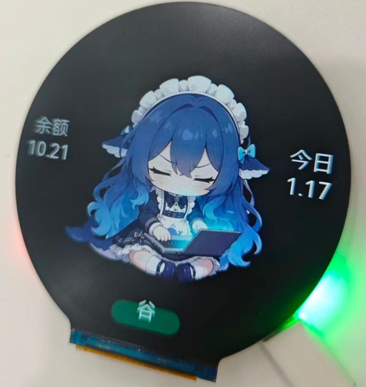
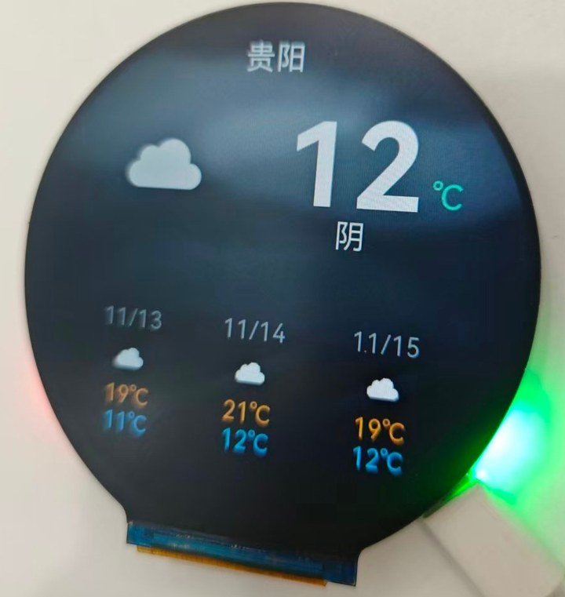
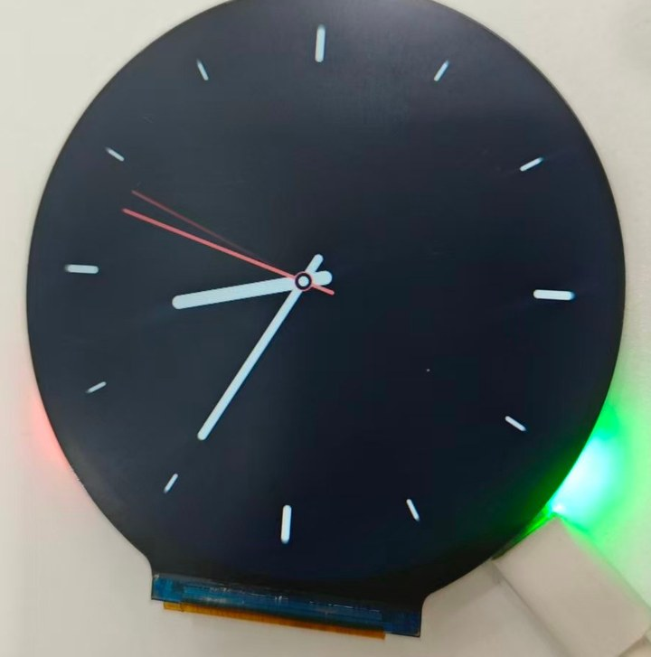

# Mochi · 桌面表情摆件

一块 **ESP32-S3-LCD-2.8C**（480×480 圆屏 + 六轴 IMU + RTC + TF 卡）做成桌面上会「活着」的小东西：
**实时显示 DeepSeek 余额、今日用量和峰谷时段**，桌宠跟着余额变化切换动作；摇一摇换应用，
应用和素材从网页装进 TF 卡，不用重刷固件。

> 🚧 **更多好玩插件开发中**：番茄钟、B 站粉丝数、GitHub 贡献热力图、股票 / 汇率看板、倒计时……
> 想要什么插件可以在 Issues 里点菜。



> 实拍：桌宠底部是 DeepSeek 余额、今日消耗和峰谷徽章（这台是「谷」时）。

| 天气 | 时钟（minimal） |
|---|---|
|  |  |

## 它能干什么

| 屏幕 | 内容 |
|---|---|
| **网络** | 没联网时提示热点名/密码；连上后显示本机 IP，局域网里用这个地址打开后台 |
| **桌宠** | 吃米饭 / 打字 / 睡觉三段动画，按 DeepSeek 余额状态自动切换；底部叠余额、今日消耗、峰谷徽章 |
| **时钟** | 三种样式：cute（奶油色 + 日期药丸）、tech（刻度 + 秒弧）、minimal（纯指针 + 可配色） |
| **天气** | 实时温度 + 未来三天，meteocons 原始动画图标 + 随天气变化的背景，中文天气词 |

**插件系统**：应用是「插件」——内置的（网络/桌宠）和卡上的（时钟/天气/你自己写的）走同一套：
manifest 描述设置项 → 网页自动生成表单 → 保存到 TF 卡 → Lua 里 `app.get()` 读。
每个插件可以单独启用/停用，摇一摇按顺序轮换。

**网页后台**：插件安装/启用/设置、WiFi 扫描与连接、OTA 升级、手势调试，全部设备自己提供 HTTP 服务（不需要连外网）。

## 快速开始

```bash
# 1. 装 ESP-IDF v5.5.x
# 2. 生成素材包（仓库里不含 assets.bin，它是从下面这些源生成出来的）
python tools/pack_assets.py --out firmware/assets/assets.bin \
    --add pet.mjp=firmware/assets/pet.mjp \
    --add work.mjp=firmware/assets/work.mjp \
    --add sleep.mjp=firmware/assets/sleep.mjp \
    --add icons.bin=firmware/assets/icons.bin \
    --add bg.bin=firmware/assets/bg.bin

# 3. 编译烧录（第一次用 flash，会同时把素材写进 assets 分区）
cd firmware
idf.py set-target esp32s3
idf.py -p COM10 flash monitor
```

第一次开机设备会把素材从 flash 分区同步到 TF 卡，然后自动擦掉那个分区——
素材只留在卡上，闪存不背这个包袱。

## 文档

| 文档 | 内容 |
|---|---|
| [docs/user-guide.md](docs/user-guide.md) | **怎么用**：屏幕、手势、网页后台、WiFi、插件装/删/设置、OTA |
| [docs/plugin-guide.md](docs/plugin-guide.md) | **怎么写插件**：目录结构、manifest、完整 Lua API、示例、调试与限制 |
| [docs/architecture.md](docs/architecture.md) | 系统设计：渲染、内存布局、素材管线、双核分工 |
| [docs/verification.md](docs/verification.md) | 实机验证记录：每一步的串口日志、踩过的坑和修法 |
| [docs/screenshots.md](docs/screenshots.md) | 怎么抓真机截图（现在仓库里的是渲染预览） |

---

## 当前状态

| 阶段 | 内容 | 状态 |
|---|---|---|
| **M1 内核** | 渲染器 / 桌宠动画 / 时钟 / 摇一摇 / 轻敲 / 翻转息屏 / RTC | 已上机：桌宠从 TF 卡播放，24fps（素材原速） |
| **M2 插件** | Lua 运行时 / 沙箱 / `ui` + `time` + `http` + `json` + `store` API | 已上机：时钟、天气两个插件跑通 |
| **M2 后台** | WiFi AP+STA、网页管理、插件安装、NTP | 已上机：自检跑通「上传→安装→列表」 |
| M3 生态 | 插件市场、更多插件（番茄钟 / 信息看板）、更多字号 | **开发中** |

完整设计见 [docs/architecture.md](docs/architecture.md)，实机记录见 [docs/verification.md](docs/verification.md)。

---

## 插件（Lua）

固件内置 Lua 5.4（32 位数值模式），插件是卡上的一个目录：

```
/sdcard/plugins/<id>/main.lua
```

```lua
local t = 0
function on_draw(dt)          -- 每帧调用
  t = t + dt
  ui.clear(0x0b0d12)
  ui.circle(240, 240, 110 + 18 * math.sin(t * 2), 0x2aa887)
  ui.text(string.format("%d", math.floor(t) % 100), 240, 240, 106, 0xffffff)
end
```

| API | 说明 |
|---|---|
| `ui.clear(color)` / `ui.bg(name)` | 整屏填充 / 画天气背景 |
| `ui.rect` `ui.round_rect` `ui.circle` `ui.ring` `ui.arc` `ui.line` | 图元，坐标为像素 |
| `ui.text(s, x, y, size, color)` | 居中绘制；`size` 分四档（106/56/29/22px） |
| `ui.measure(s, size)` | 量文字宽度，排版用 |
| `ui.icon(name, size, cx, cy)` | 画内置天气图标（120/64） |
| `time.now()` / `time.epoch()` | 本地时间表 / unix 秒 |
| `app.get(key)` | 读插件设置 |
| `http.get(url, cb)` | 异步 GET，`cb(status, body)`，同 URL 2 分钟内走缓存 |
| `json.decode(s)` | JSON → 表 |
| `net.up()` | WiFi 是否已连上（发请求前先判断） |
| `store.get/set(key, val)` | 插件自己的持久化键值（存卡上） |
| `log(s)` | 打到串口 |

颜色是 `0xRRGGBB`，要半透明就写 `0xAARRGGBB`。可选 `on_start()` 在每次进屏时调用一次。

> 完整的 API 说明、字号能画什么字、内存与指令限制、调试方法，见
> **[docs/plugin-guide.md](docs/plugin-guide.md)**。

### 插件设置

manifest 里用 `settings` 描述表单，网页会自动生成控件：

```json
"settings": [
  {"key": "lat", "label": "纬度", "type": "number", "default": "22.54"},
  {"key": "unit", "label": "单位", "type": "select", "options": ["c", "f"], "default": "c"},
  {"key": "bg",  "label": "背景色", "type": "color", "default": "#0F1115"}
]
```

`type` 支持 `text` / `number` / `select` / `color`。值存在 `/sdcard/plugins/<id>/settings.json`，
插件里用 `app.get("lat")` 读；网页点插件名字就能改，保存后插件会自动重载。

### 示例插件：时钟

三种样式，在插件详情页切换：

| 样式 | 样子 |
|---|---|
| `cute` | 奶油色背景、小太阳、大号时间、日期药丸（含「周几」）、秒进度环 |
| `tech` | 深色背景、60 格刻度、秒弧 + 游标、`2026.11.12 THU` |
| `minimal` | 只有时针/分针/秒针和 12 个刻度，背景色、指针色、秒针色都可调 |

`minimal` 的三个颜色用 `type: "color"` 的色板选，存成 `#RRGGBB`。

### 示例插件：天气

实时天气 + 未来三天，中文显示，温度后面跟 ℃，图标是 **meteocons 的原始动画**：

```
       深圳              [太阳转动的图标]
                         13℃
                         多云
     ────────────────────────
     11/13     11/14     11/15    ← 日期
      [雨]      [云]      [晴]     ← 动画图标
      20℃       22℃       19℃     ← 高温，橙色
      11℃       12℃       10℃     ← 低温，蓝色
```

地名取插件设置里的「地名」字段；字段为空时默认显示「深圳」。
只有内置字体里的字能显示（ASCII + 约 40 个常用城市名），其它字会被跳过。

用的是 **Open-Meteo**：免费、**不用注册、不需要 API key**、HTTPS JSON。

**素材全部在 TF 卡上**，不占闪存：

- `/sdcard/icons.bin` —— 15 个图标 × 8 帧（96px）+ 64px 静态小图，RGB565 + A8
- `/sdcard/plugins/weather/data.json` —— 上次拉到的天气 JSON + 时间戳

拉取策略：进屏先用缓存渲染，超过 10 分钟才重新请求；请求失败也保留旧数据不报错
（只有一条数据都没有时才显示「等待网络 / 加载中 / 网络错误」）。

**沙箱**：堆在 PSRAM、上限 192KB；单帧 12 万条指令预算；只开 base/string/table/math/utf8/coroutine，没有 `io`/`os`/`package`/`debug`，插件拿不到文件和系统调用。

应用顺序：网络 → 桌宠 → **每个已启用插件一屏**，摇一摇或按 BOOT 轮换。
网络和桌宠也是「内置插件」：有 manifest、有详情页、能被停用，只是代码编在固件里。
网页上每行右边的勾就是启用开关，全部停用时保底显示网络屏。

**网络屏**：没连 WiFi 时开机停在这一屏，提示热点名/密码和 `http://192.168.4.1`；
连上家里 WiFi 后显示路由器分配的 IP（局域网里用这个地址访问），展示几秒后自动进桌宠。

## 桌宠 / DeepSeek 余额

桌宠按余额状态换动画，屏幕底部有三块信息：

```
        [工作动画 / 吃饭动画 / 睡觉动画]

  ( ￥5.69 )        ( 今日 0.12 )        ← 左右两个奶油色气泡
                [ 谷 ]                  ← 正下方峰谷徽章
```

**动画状态机**（每 5 分钟查一次余额）：

| 条件 | 动画 |
|---|---|
| 余额在下降（最近 5 分钟内掉过） | `work.mjp` 打字工作 |
| 5 分钟没变化 | `pet.mjp` 吃饭 |
| 30 分钟没变化 | `sleep.mjp` 睡觉 |

余额变化时间存在 NVS，重启后接着算。

**数据来源**：

- **余额**：`GET https://api.deepseek.com/user/balance`，`Authorization: Bearer <API_KEY>`，
  在网页「桌宠 → 详情」填 key，不需要账号登录
- **今日消耗**：官方没有用量接口，用「当天首次读到的余额 − 当前余额」估算，基线存 NVS
- **峰谷**：按官方定价页的时段算。峰时 = UTC 01:00–04:00 与 06:00–10:00、周一至周五，
  换成北京时间是 **09:00–12:00 和 14:00–18:00**；其余时段（含周末、法定节假日）都是谷时。
  显示 `谷` 用薄荷绿、`峰` 用琥珀色。**法定节假日没有内置日历**，节假日当天会按工作日算。

没填 key 显示 `SET API KEY`，key 无效显示 `KEY INVALID`。key 明文存在
`/sdcard/plugins/pet/settings.json`，不编进固件。

**素材怎么进卡**：电脑不能直接写卡，所以三段动画打包成 `assets.bin` 烧到 assets 分区，
开机时 `assets_sync()` 只把「大小或内容不一致」的文件写到 `/sdcard/`。换素材：

```bash
python tools/pack_dir.py --dir <帧目录> --out firmware/assets/work.mjp --fps 24
python tools/pack_assets.py --out firmware/assets/assets.bin \
    --add pet.mjp=firmware/assets/pet.mjp \
    --add work.mjp=firmware/assets/work.mjp \
    --add sleep.mjp=firmware/assets/sleep.mjp
```

---

## 网页后台

设备永远开一个热点：

- SSID **`Mochi-XXXX`**（后四位是 MAC），密码 **`mochi1234`**
- 浏览器打开 **http://192.168.4.1**

| 功能 | 说明 |
|---|---|
| 状态 | 当前应用、帧率、内存、热点、IP |
| 插件 | 列表、启用、删除、**详情页**（manifest 信息 + 按 schema 生成的设置表单） |
| 安装 | 多选 `manifest.json` + `main.lua` 上传，装到 `/sdcard/plugins/<id>/`；或装内置示例 |
| 控制 | 上一个 / 下一个 / 轻敲 / 摇一摇（远程切屏，调试用） |
| WiFi | 扫描附近 SSID（带信号强度）、点击填入、连接状态与失败原因、保存后自动对时 |
| 固件 | 上传 `.bin` OTA 升级 |

连上家里 WiFi 后，设备在局域网里也能访问：状态卡会同时显示「热点地址」和「局域网地址」，
屏幕上也会显示路由器分配的 IP。

REST 接口：

```
GET    /api/status
GET    /api/scan                                扫描附近 WiFi
GET    /api/apps
GET    /api/app?id=<plugin>                     manifest + 当前设置
POST   /api/app/settings?id=<plugin>            body 是扁平 JSON
POST   /api/app/enable?id=<plugin>&on=0|1       启用 / 停用
GET    /api/builtin                             内置示例列表
POST   /api/builtin/install?id=<plugin>         把内置示例写到卡上
POST   /api/upload?id=<plugin>&file=<name>     原始 body 写文件
POST   /api/install?id=<plugin>                校验 manifest + main.lua
POST   /api/active?id=<plugin>
DELETE /api/app?id=<plugin>
POST   /api/gesture?event=next|prev|tap|shake
POST   /api/wifi?ssid=..&pass=..
POST   /api/ota                                原始固件
```

> 插件不打包成 zip：浏览器直接把选中的文件逐个 POST 上来，设备端不引入解压库。

---

## 素材放 TF 卡

桌宠是 53 帧 480×480 的 JPEG 序列（`pet.mjp`，1.14MB，24fps / 2.21 秒循环），运行时从 TF 卡加载：

- 文件位置：`/sdcard/pet.mjp`（卡根目录）
- 后台任务环形预读 **576KB**（12 帧），边读边解，不再整段缓存
- 卡上没有、而 flash 的 `assets` 分区还有旧副本时，会自动拷到卡上（一次性）
- 两个都没有 → 屏幕显示 `NO ASSET`

换素材只要替换卡上这个文件；`.mjp` 用 `tools/pack_clip.py` 从 PNG 序列生成
（优先用包里的 `frames_rgb`，没有就把 `frames_alpha` 合成到黑底；当前是 `--quality 82`）。

> 实测 40MHz 下单卡顺序读 1.23MB/s，播放消耗约 0.5MB/s，预读余量很大。
> 加载后 PSRAM 还剩 ~5.6MB，M2 的插件可以放开用。

---

## 为什么不是 GIF

表情是**代码画出来的**，不是预制动画：

- 眨眼间隔随机、偶尔连眨；
- 眼睛跟着板子的倾斜移动（QMI8658），还会自己瞟一眼；
- 单击会眯眼笑 + 弹一下，双击会转晕冒星星；
- 呼吸缩放、体块渐变全部每帧计算。

这样 480×480 只占几十 KB 代码，而且切换状态不会卡；换成 GIF/视频，
每个状态都要几百 KB，还没法随机。

---

## 硬件

ESP32-S3-LCD-2.8C（ESP32-S3R8，16MB Flash / 8MB Octal PSRAM）：

- 2.8 寸 480×480 圆屏，ST7701S + RGB565 并口
- QMI8658 六轴、PCF85063 RTC、TCA9554 IO 扩展、蜂鸣器
- USB-C 直接烧录（板载 CH343P / USB-Serial-JTAG）

引脚定义在 `firmware/main/board.h`，和微雪官方示例一致。

---

## 编译 / 烧录

环境：ESP-IDF **v5.5.2**，目标 `esp32s3`。

```powershell
$env:IDF_PATH='D:\esp\esp-idf'
$env:IDF_TOOLS_PATH='D:\esp\.espressif'
. D:\esp\esp-idf\export.ps1

cd firmware
idf.py build
idf.py -p COM10 flash monitor
```

串口日志正常应该看到：

```
I (xxx) io: TCA9554 ready, input=0x00
I (xxx) rtc: RTC 2026-11-12 13:40:00
I (xxx) lcd: frame buffers in psram: 3 x 450 KB
I (xxx) imu: found QMI8658 at 0x6B, WHO_AM_I=0x05
I (xxx) mochi: ========== Mochi 0.1 ==========
```

---

## 交互

| 动作 | 效果 |
|---|---|
| 摇一摇 | 下一个应用（表情 ↔ 时钟） |
| 单击（敲桌面/轻碰板子） | 表情：眯眼笑 + 弹一下 |
| 双击 | 表情：转晕、冒星星 |
| 屏幕朝下放 | 息屏 |
| 翻回来 / 摇一下 | 亮屏 |
| BOOT 键短按 | 下一个应用 |

阈值在 `imu.c` 顶部，实机按手感调。

---

## 关于这个项目

### 想做什么

AWTRIX 证明了「一块小屏 + 几个像素动画」放在桌上是会让人心情变好的东西。我想做一个更像「宠物」的版本：

- **它有自己的状态**，不是循环播放的 GIF。余额在掉说明你在干活，它就打字；一阵没动静它就吃饭；一小时没动静就睡觉。
- **它是可扩展的**。今天想做天气，明天想做番茄钟，不应该为此重新刷固件。
- **它自己活着**。开机能连 WiFi、能对时、能在网页上配置，不需要一台常开的电脑伺候它。

### 为什么不用 LVGL

这个项目的画面本质上只有几类东西：纯色块、圆、线、文字。LVGL 能画，但它带来的对象树、样式系统、
内存池在 480×480 RGB565 + PSRAM 帧缓冲这个场景里是纯开销——渲染一帧要遍历对象树、算脏区、再逐层合成。

所以我写了一个 ~450 行的扫描线渲染器（`gfx.c`）：每个图元直接往帧缓冲的 span 上写，
距离场做抗锯齿。整屏填充 450KB 大约 18ms（PSRAM 带宽瓶颈），全套 3 个图元 + 文字能跑到 43fps（面板上限）。

代价是没有现成的控件库，按钮、列表、滚动都要自己画——但这也正好符合「一块表盘」的需求。

### 几个关键取舍

| 决定 | 原因 |
|---|---|
| **素材全放 TF 卡** | 8MB PSRAM 里要放 3 块帧缓冲（1.35MB）+ 视频环形缓冲（576KB）+ Lua 堆，素材塞 flash 会把 OTA 分区挤爆 |
| **视频用 MJPEG 而不是 GIF** | 用芯片自带的 JPEG 解码器（SIMD）解 480×480 单帧约 10ms，GIF 的 LZW 是纯软件解码且只有 256 色 |
| **插件用 Lua 而不是 C** | 插件是用户写的，不该让他为了加个时钟去学 ESP-IDF、配工具链。Lua 5.4 加 192KB 堆上限 + 单帧指令预算，跑飞了只会显示错误屏，不会拖垮整机 |
| **插件即应用** | 没有「插件容器」这一层概念：一个插件就是一块屏幕，摇一摇轮换，和内置的桌宠、网络平级 |
| **素材下发走 assets 分区** | 电脑不能直接写卡，所以素材先烧进 flash 分区，设备开机自己拷到卡上，拷完把分区擦掉——既不用读卡器，也不长期占闪存 |

### 技术栈

| 层 | 用了什么 |
|---|---|
| 芯片 | ESP32-S3（双核 240MHz，8MB PSRAM，16MB flash） |
| 框架 | ESP-IDF v5.5.2 |
| 屏幕 | ST7701S 480×480 RGB 面板 + 3 块 PSRAM 帧缓冲 |
| 图形 | 自己写的 SDF 扫描线渲染器（`gfx.c`） |
| 视频 | esp_new_jpeg（SIMD 解码）+ 自研 MJP1 容器 |
| 脚本 | Lua 5.4.7（32 位数值，跑在独立状态机里） |
| 网络 | lwIP + esp_http_server + mbedTLS 证书链 |
| 数据 | Open-Meteo（天气）、DeepSeek（余额） |

### 接下来

- **更多插件（开发中）**：番茄钟、B 站粉丝数、GitHub 贡献热力图、股票/汇率、倒计时、天气预警
- **插件市场**：网页上浏览+一键安装，不用自己挑文件上传
- **截图接口** `/api/shot.jpg`：把当前帧编码成 JPEG，写文档、远程看屏都方便
- **更多字号与矢量图标**：现在字号只有四档，天气图标是位图

### 致谢

- [Lua](https://www.lua.org/) —— MIT
- [esp_new_jpeg](https://github.com/espressif/esp-adf-libs) —— Apache-2.0
- [Meteocons](https://meteocons.com/) —— MIT，天气图标和背景
- [AWTRIX](https://github.com/Blueforcer/awtrix3) —— 灵感来源

---

## 目录

```
mochi/
├─ firmware/
│  ├─ main/
│  │  ├─ main.c            启动顺序、主循环、串口命令
│  │  ├─ gfx.c / gfx.h     SDF 抗锯齿渲染器（480×480 RGB565）
│  │  ├─ fonts.c           字体图集（tools/gen_font.py 生成）
│  │  ├─ apps.c            应用/插件槽位管理、淡入淡出、启用过滤
│  │  ├─ app_pet.c         桌宠：MJPEG 流式播放 + 三段动画切换 + 余额 HUD
│  │  ├─ app_net.c         网络屏（IP / 热点提示）
│  │  ├─ builtin_apps.c    内置插件（网络、桌宠）的 manifest 注册表
│  │  ├─ builtin_plugins.c 卡上示例插件（时钟、天气）的源码与自动安装
│  │  ├─ lua_rt.c          Lua 运行时：沙箱、ui/time/http/json/store API
│  │  ├─ plugins.c         插件扫描、启用/停用（NVS 停用名单）
│  │  ├─ plugin_conf.c     插件设置（settings.json）
│  │  ├─ icons.c           天气图标包读取 + alpha 贴图（4 槽 LRU 缓存）
│  │  ├─ bg.c              天气背景解码缓存 + 整帧拷贝
│  │  ├─ assets.c          assets 分区 → TF 卡同步（写完擦除分区）
│  │  ├─ dsec.c            DeepSeek 余额/今日消耗/峰谷 + 桌宠状态机
│  │  ├─ net.c             AP+STA、WiFi 扫描、SNTP、断线重连
│  │  ├─ web.c             HTTP 服务与全部 API
│  │  ├─ www.h             内嵌网页（gzip，tools/build_www.py 生成）
│  │  ├─ lcd.c / io.c      屏幕与 IO 扩展（ST7701S / TCA9554）
│  │  ├─ imu.c             QMI8658 + 手势识别（摇一摇/翻转）
│  │  ├─ rtc.c             PCF85063 + 编译时刻兜底
│  │  └─ sd.c              SDMMC 1-bit 挂载与写重试
│  ├─ components/
│  │  ├─ lua/              随仓库携带的 Lua 5.4.7
│  │  └─ esp_new_jpeg/     预编译 JPEG 解码器（只保留 esp32s3）
│  ├─ assets/              pet/work/sleep.mjp、icons.bin、bg.bin
│  └─ partitions.csv
├─ tools/
│  ├─ gen_font.py          TTF → 固件字体（ASCII + 中文白名单）
│  ├─ pack_dir.py          目录里的 PNG 序列 → MJP1
│  ├─ pack_clip.py         zip 里的帧序列 → MJP1
│  ├─ pack_assets.py       多个素材 → assets.bin
│  ├─ pack_icons.py        图标包（RGB565+A8）
│  ├─ pack_bg.py           天气背景包（JPEG）
│  ├─ build_www.py         网页 → gzip → www.h
│  ├─ preview.py           预览图渲染（设计用，不参与构建）
│  └─ capture.py           串口 ASCII 截图（调试用）
├─ webui/index.html        网页后台源码
├─ weather-bg*/            天气背景源图
└─ docs/                   使用手册 / 插件指南 / 设计 / 验证记录
```

---

## 已知限制

- **整屏重绘受 PSRAM 带宽限制**：填 450KB 约 18ms，所以 Lua 插件一帧只有 5ms 左右留给内容绘制，
  画太满会掉帧（桌宠那屏 41ms/帧，基本吃满）。
- **中文字表是白名单**：现在约 200 字（时间词、天气词、20 个城市名），不在表里的字显示成空白，
  要加字得改 `tools/gen_font.py` 重新生成字体。
- **今日消耗是估算**：官方没有用量接口，按余额下降累加；关机期间「又花钱又充值」的差额算不出来。
- **法定节假日没日历**：峰谷按工作日算，节假日当天会误判成峰时。
- **插件不能写文件**：没有 `io`/`os`，持久化只能用 `store`（键值字符串）。
- **素材更新要整包重烧**：assets 分区是一次性分发通道，改一张图也要重新 `idf.py flash`。
- **OTA 不校验签名**：目前只校验镜像有效性，没有做安全启动。`
- `tools/preview.py` 是独立实现（Pillow），只用来定视觉；像素级以 `gfx.c` 为准。
