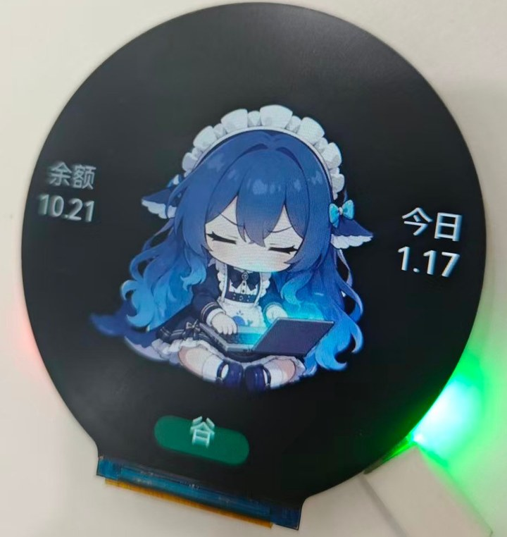
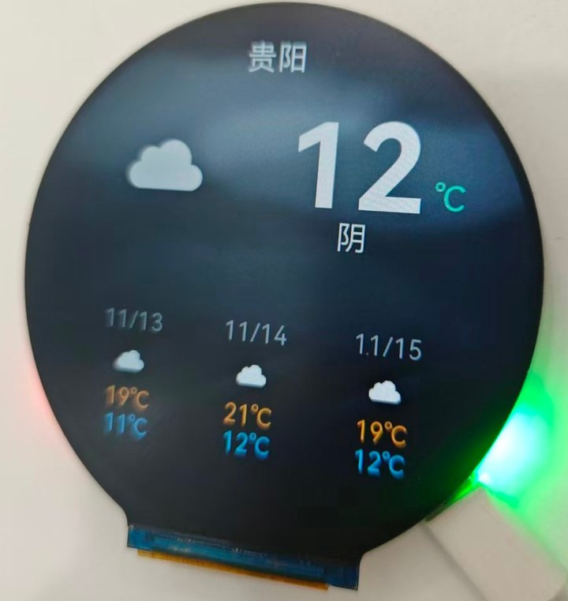
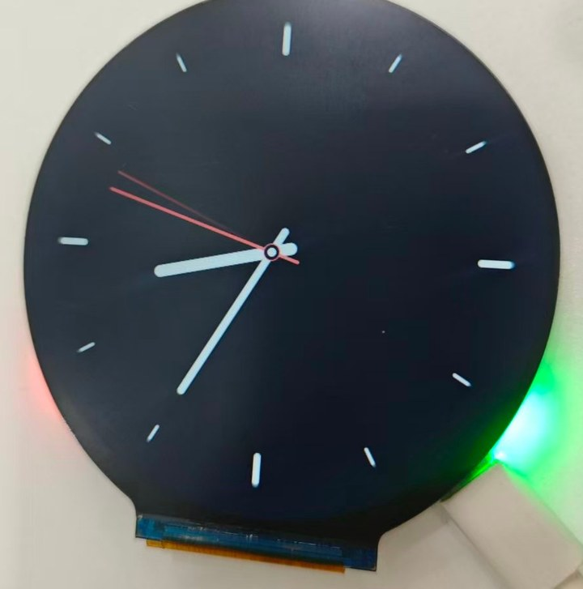

[中文](README.md) · **English**

# Mochi · a desk ornament with expressions

An **ESP32-S3-LCD-2.8C** (480×480 round screen + 6-axis IMU + RTC + TF card) turned into a little thing on your desk that "lives":
**it shows your DeepSeek balance, today's usage and peak/off-peak periods in real time**, and the pet switches animations as the balance changes; shake to change apps,
and apps and assets are installed from the web console onto the TF card — no firmware reflash.

> 🚧 **More fun plugins in the works**: Pomodoro timer, Bilibili follower count, GitHub contribution heatmap, stocks / FX dashboard, countdown…
> Want something? Request it in Issues.



> Shot on device: the bottom of the pet shows the DeepSeek balance, today's spend and the peak/off-peak badge (this unit is in "off-peak").

| Weather | Clock (minimal) |
|---|---|
|  |  |

## What it does

| Screen | Contents |
|---|---|
| **Network** | With no network it shows the hotspot name/password; once connected it shows the local IP — open the console from your LAN at that address |
| **Pet** | Three animation clips — eating rice / typing / sleeping — switched automatically by DeepSeek balance state; balance, today's spend and the peak/off-peak badge overlaid at the bottom |
| **Clock** | Three styles: cute (cream + date pill), tech (tick marks + seconds arc), minimal (hands only + configurable colors) |
| **Weather** | Live temperature + next three days, original meteocons animated icons + weather-dependent background, Chinese weather words |
| **Delta Force** | Nickname, battlefield rank score, liquid/illiquid assets, recent gain (red up / green down with arrows) — data pushed by tools/df_sync.py on your computer |

**Plugin system**: apps are "plugins" — built-in ones (network/pet) and card ones (clock/weather/your own) go through the same path:
the manifest describes the settings → the web console generates the form automatically → saved to the TF card → read in Lua with `app.get()`.
Each plugin can be enabled/disabled individually; shake cycles through them in order.

**Web console**: plugin install/enable/settings, WiFi scan and connect, OTA update, gesture debugging — the device serves HTTP itself (no internet required).

## Quick start

**Don't want to compile?** Grab `mochi-1.0.0-full.bin` from [Releases](https://github.com/z464244404/mochi/releases)
and flash it with one command (includes bootloader, partition table, firmware, assets):

```bash
esptool --chip esp32s3 -p COM10 write_flash 0x0 mochi-1.0.0-full.bin
```

Building from source:

```bash
# 1. install ESP-IDF v5.5.x
# 2. build the asset pack (the repo does not ship assets.bin; it is generated from these sources)
python tools/pack_assets.py --out firmware/assets/assets.bin \
    --add pet.mjp=firmware/assets/pet.mjp \
    --add work.mjp=firmware/assets/work.mjp \
    --add sleep.mjp=firmware/assets/sleep.mjp \
    --add icons.bin=firmware/assets/icons.bin \
    --add bg.bin=firmware/assets/bg.bin

# 3. build and flash (the first flash also writes the assets partition)
cd firmware
idf.py set-target esp32s3
idf.py -p COM10 flash monitor
```

On first boot the device syncs the assets from the flash partition to the TF card, then erases that partition —
the assets live only on the card, so flash doesn't carry the burden.

## Documentation

| Doc | Contents |
|---|---|
| [docs/user-guide.md](docs/user-guide.en.md) | **How to use it**: screen, gestures, web console, WiFi, installing/removing/configuring plugins, OTA |
| [docs/plugin-guide.md](docs/plugin-guide.en.md) | **How to write a plugin**: directory layout, manifest, full Lua API, examples, debugging and limits |
| [docs/api.md](docs/api.en.md) | **HTTP API**: parameters for every endpoint, sample responses, curl usage |
| [docs/dfm.md](docs/dfm.en.md) | **Delta Force plugin**: login, push script, field sources |
| [docs/hardware.md](docs/hardware.en.md) | **Hardware**: pin table, I2C addresses, IO expander, TF card wiring, memory map |
| [docs/architecture.md](docs/architecture.en.md) | System design: rendering, memory layout, asset pipeline, dual-core split |
| [docs/verification.md](docs/verification.md) | On-device verification log: serial output for each step, pitfalls and fixes *(Chinese only)* |
| [docs/screenshots.md](docs/screenshots.en.md) | Where the screenshots come from (photos + render previews) |

---

## Current status

| Stage | Contents | Status |
|---|---|---|
| **M1 core** | Renderer / pet animation / clock / shake / tap / flip to sleep / RTC | On device: pet plays from the TF card at 24fps (the assets' native speed) |
| **M2 plugins** | Lua runtime / sandbox / `ui` + `time` + `http` + `json` + `store` APIs | On device: clock and weather plugins both work |
| **M2 console** | WiFi AP+STA, web management, plugin install, NTP | On device: self-test covers "upload → install → list" |
| M3 ecosystem | Plugin market, more plugins (Pomodoro / info dashboard), more font sizes | **In progress** |

Full design in [docs/architecture.md](docs/architecture.en.md), on-device record in [docs/verification.md](docs/verification.md).

---

## Plugins (Lua)

The firmware ships Lua 5.4 (32-bit numeric mode); a plugin is a directory on the card:

```
/sdcard/plugins/<id>/main.lua
```

```lua
local t = 0
function on_draw(dt)          -- 每帧调用
  t = t + dt
  ui.clear(0x0b0d12)
  ui.circle(240, 240, 110 + 18 * math.sin(t * 2), 0x2aa887)
  ui.text(string.format("%d", math.floor(t) % 100), 240, 240, 106, 0xffffff)
end
```

| API | Description |
|---|---|
| `ui.clear(color)` / `ui.bg(name)` | Fill the whole screen / draw the weather background |
| `ui.rect` `ui.round_rect` `ui.circle` `ui.ring` `ui.arc` `ui.line` | Primitives, coordinates in pixels |
| `ui.text(s, x, y, size, color)` | Centered draw; `size` has four steps (106/56/29/22px) |
| `ui.measure(s, size)` | Measure text width, for layout |
| `ui.icon(name, size, cx, cy)` | Draw a built-in weather icon (120/64) |
| `time.now()` / `time.epoch()` | Local time table / unix seconds |
| `app.get(key)` | Read plugin settings |
| `http.get(url, cb)` | Async GET, `cb(status, body)`, same URL cached for 2 minutes |
| `json.decode(s)` | JSON → table |
| `net.up()` | Whether WiFi is connected (check before sending requests) |
| `store.get/set(key, val)` | The plugin's own persistent key-value store (on the card) |
| `log(s)` | Print to serial |

Colors are `0xRRGGBB`; for alpha write `0xAARRGGBB`. An optional `on_start()` is called once each time the screen is entered.

> For the full API reference, which glyphs each font size can draw, memory and instruction limits, and debugging,
> see **[docs/plugin-guide.md](docs/plugin-guide.en.md)**.

### Plugin settings

The manifest describes the form with `settings`, and the web console generates the controls automatically:

```json
"settings": [
  {"key": "lat", "label": "Latitude", "type": "number", "default": "22.54"},
  {"key": "unit", "label": "Unit", "type": "select", "options": ["c", "f"], "default": "c"},
  {"key": "bg",  "label": "Background", "type": "color", "default": "#0F1115"}
]
```

`type` supports `text` / `number` / `select` / `color`. Values live in `/sdcard/plugins/<id>/settings.json`
and are read in the plugin with `app.get("lat")`; click the plugin name in the web console to edit them, and the plugin reloads automatically after saving.

### Example plugin: Clock

Three styles, switchable on the plugin detail page:

| Style | Look |
|---|---|
| `cute` | Cream background, small sun, large time, date pill (with weekday), seconds progress ring |
| `tech` | Dark background, 60 tick marks, seconds arc + cursor, `2026.11.12 THU` |
| `minimal` | Only hour/minute/second hands and 12 tick marks; background color, hand color and second-hand color are all adjustable |

The three colors of `minimal` are picked with a `type: "color"` swatch and stored as `#RRGGBB`.

### Example plugin: Weather

Live weather + the next three days, shown in Chinese, with ℃ after the temperature; the icons are **original meteocons animations**:

```
       深圳              [太阳转动的图标]
                         13℃
                         多云
     ────────────────────────
     11/13     11/14     11/15    ← 日期
      [雨]      [云]      [晴]     ← 动画图标
      20℃       22℃       19℃     ← 高温，橙色
      11℃       12℃       10℃     ← 低温，蓝色
```

The place name comes from the "location" field in the plugin settings; when it is empty it defaults to "深圳" (Shenzhen).
Only glyphs in the built-in font can be displayed (ASCII + about 40 common city names); other characters are skipped.

It uses **Open-Meteo**: free, **no sign-up, no API key**, HTTPS JSON.

**All assets live on the TF card**, using no flash:

- `/sdcard/icons.bin` — 15 icons × 8 frames (96px) + 64px static thumbnails, RGB565 + A8
- `/sdcard/plugins/weather/data.json` — the last fetched weather JSON + timestamp

Fetch policy: on entering the screen render from cache first, only re-request after 10 minutes; on failure keep the old data and don't raise an error
(only when there is no data at all does it show "waiting for network / loading / network error").

**Sandbox**: heap in PSRAM, 192KB cap; a 120k instruction budget per frame; only base/string/table/math/utf8/coroutine are open — no `io`/`os`/`package`/`debug`, so plugins cannot reach files or system calls.

App order: network → pet → **one screen per enabled plugin**; shake or press BOOT to cycle.
Network and pet are also "built-in plugins": they have a manifest, a detail page and can be disabled — the code is just compiled into the firmware.
The checkbox at the right of each row in the web console is the enable switch; when everything is disabled the network screen is shown as a fallback.

**Network screen**: with no WiFi it stays on this screen at boot, showing the hotspot name/password and `http://192.168.4.1`;
after joining your home WiFi it shows the router-assigned IP (use that address on the LAN) and enters the pet screen after a few seconds.

## Pet / DeepSeek balance

The pet changes animation with the balance state, and the bottom of the screen carries three info blocks:

```
        [工作动画 / 吃饭动画 / 睡觉动画]

  ( ￥5.69 )        ( 今日 0.12 )        ← 左右两个奶油色气泡
                [ 谷 ]                  ← 正下方峰谷徽章
```

**Animation state machine** (balance polled every 5 minutes):

| Condition | Animation |
|---|---|
| Balance dropping (dropped within the last 5 minutes) | `work.mjp` typing |
| No change for 5 minutes | `pet.mjp` eating |
| No change for 30 minutes | `sleep.mjp` sleeping |

The balance-change timestamp is stored in NVS and resumes after a reboot.

**Data sources**:

- **Balance**: `GET https://api.deepseek.com/user/balance`, `Authorization: Bearer <API_KEY>`,
  enter the key in the web console under "Pet → Detail", no account login needed
- **Today's usage**: there is no official usage endpoint, so it is estimated as "balance at first read today − current balance"; the baseline is stored in NVS
- **Peak/off-peak**: computed from the time windows on the official pricing page. Peak = UTC 01:00–04:00 and 06:00–10:00, Monday to Friday,
  which in Beijing time is **09:00–12:00 and 14:00–18:00**; every other period (including weekends and public holidays) is off-peak.
  The `谷` (off-peak) badge is mint green and `峰` (peak) is amber. **There is no built-in public-holiday calendar**, so holidays are counted as weekdays.

With no key it shows `SET API KEY`; with an invalid key, `KEY INVALID`. The key is stored in plaintext at
`/sdcard/plugins/pet/settings.json` and is never compiled into the firmware.

**How assets get onto the card**: a computer cannot write the card directly, so the three animation clips are packed into `assets.bin` and flashed to the assets partition;
at boot `assets_sync()` writes only the files whose "size or content differ" to `/sdcard/`. To change assets:

```bash
python tools/pack_dir.py --dir <帧目录> --out firmware/assets/work.mjp --fps 24
python tools/pack_assets.py --out firmware/assets/assets.bin \
    --add pet.mjp=firmware/assets/pet.mjp \
    --add work.mjp=firmware/assets/work.mjp \
    --add sleep.mjp=firmware/assets/sleep.mjp
```

---

## Web console

The device always runs a hotspot:

- SSID **`Mochi-XXXX`** (the last four digits are the MAC), password **`mochi1234`**
- Open **http://192.168.4.1** in a browser

| Feature | Description |
|---|---|
| Status | Current app, frame rate, memory, hotspot, IP |
| Plugins | List, enable, delete, **detail page** (manifest info + settings form generated from the schema) |
| Install | Multi-select `manifest.json` + `main.lua` upload, installed to `/sdcard/plugins/<id>/`; or install built-in examples |
| Control | Previous / next / tap / shake (remote screen switching, for debugging) |
| WiFi | Scan nearby SSIDs (with signal strength), click to fill in, connection state and failure reason, auto time sync after saving |
| Firmware | Upload a `.bin` for OTA update |

Once joined to your home WiFi the device is also reachable on the LAN: the status card shows both the "hotspot address" and the "LAN address",
and the screen shows the router-assigned IP.

REST endpoints:

```
GET    /api/status
GET    /api/scan                                scan nearby WiFi
GET    /api/apps
GET    /api/app?id=<plugin>                     manifest + current settings
POST   /api/app/settings?id=<plugin>            body is flat JSON
POST   /api/app/enable?id=<plugin>&on=0|1       enable / disable
GET    /api/builtin                             list built-in samples
POST   /api/builtin/install?id=<plugin>         install a sample to the card
POST   /api/upload?id=<plugin>&file=<name>      raw body written to file
POST   /api/install?id=<plugin>                 validate manifest + main.lua
POST   /api/active?id=<plugin>
DELETE /api/app?id=<plugin>
POST   /api/gesture?event=next|prev|tap|shake
POST   /api/wifi?ssid=..&pass=..
POST   /api/ota                                 raw firmware image
```

> Plugins are not packaged as zip: the browser POSTs each selected file individually, so the device doesn't pull in a decompression library.

---

## Assets on the TF card

The pet is a 53-frame 480×480 JPEG sequence (`pet.mjp`, 1.14MB, 24fps / 2.21 s loop), loaded from the TF card at runtime:

- Location: `/sdcard/pet.mjp` (card root)
- A background task ring-prefetches **576KB** (12 frames), decoding as it reads; no whole-clip caching
- If it is missing from the card but the flash `assets` partition still has an old copy, it is copied to the card automatically (one time)
- Neither → the screen shows `NO ASSET`

To change assets, just replace this file on the card; `.mjp` is produced from a PNG sequence with `tools/pack_clip.py`
(it prefers `frames_rgb` from the archive, otherwise composites `frames_alpha` onto black; currently `--quality 82`).

> Measured: 1.23MB/s sequential read from a single card at 40MHz, playback consumes about 0.5MB/s, so there is plenty of prefetch headroom.
> After loading, ~5.6MB of PSRAM is still free — M2 plugins can use it freely.

---

## Why not GIF

The expressions are **drawn in code**, not pre-made animation:

- Blink intervals are random, with occasional double blinks;
- The eyes follow the board's tilt (QMI8658) and glance sideways on their own;
- A single tap squints and smiles with a bounce; a double tap spins the eyes dizzy with stars;
- Breathing scale and body-block gradients are all computed per frame.

This way 480×480 costs only a few tens of KB of code, and state changes don't stutter; with GIF/video
each state would be hundreds of KB and could not be randomized.

---

## Hardware

ESP32-S3-LCD-2.8C (ESP32-S3R8, 16MB flash / 8MB octal PSRAM):

- 2.8-inch 480×480 round screen, ST7701S + RGB565 parallel
- QMI8658 6-axis, PCF85063 RTC, TCA9554 IO expander, buzzer
- USB-C direct flashing (onboard CH343P / USB-Serial-JTAG)

Pin definitions are in `firmware/main/board.h`, identical to the Waveshare official examples.

---

## Build / flash

Environment: ESP-IDF **v5.5.2**, target `esp32s3`.

```powershell
$env:IDF_PATH='D:\esp\esp-idf'
$env:IDF_TOOLS_PATH='D:\esp\.espressif'
. D:\esp\esp-idf\export.ps1

cd firmware
idf.py build
idf.py -p COM10 flash monitor
```

The serial log should look like this:

```
I (xxx) io: TCA9554 ready, input=0x00
I (xxx) rtc: RTC 2026-11-12 13:40:00
I (xxx) lcd: frame buffers in psram: 3 x 450 KB
I (xxx) imu: found QMI8658 at 0x6B, WHO_AM_I=0x05
I (xxx) mochi: ========== Mochi 0.1 ==========
```

---

## Interaction

| Action | Effect |
|---|---|
| Shake | Next app (expressions ↔ clock) |
| Single tap (tap the desk / nudge the board) | Expressions: squint smile + bounce |
| Double tap | Expressions: dizzy spin, stars |
| Screen face down | Screen off |
| Flip back / shake once | Screen on |
| Short press BOOT | Next app |

The thresholds are at the top of `imu.c`; tune them by feel on the device.

---

## About this project

### What I wanted to build

AWTRIX proved that a small screen plus a few pixel animations on your desk makes you feel better. I wanted a version that feels more like a "pet":

- **It has its own state**, it is not a looping GIF. A falling balance means you are working, so it types; after a while of silence it eats; after an hour of silence it sleeps.
- **It is extensible.** Wanting weather today and a Pomodoro timer tomorrow shouldn't require reflashing firmware.
- **It lives on its own.** It joins WiFi at boot, syncs time and is configurable from the web console — no always-on computer babysitting it.

### Why not LVGL

Visually this project only has a few kinds of things: solid blocks, circles, lines, text. LVGL can draw them, but the object tree, style system and
memory pool it brings are pure overhead in a 480×480 RGB565 + PSRAM framebuffer setting — rendering a frame means walking the object tree, computing dirty regions, then compositing layer by layer.

So I wrote a ~450-line scanline renderer (`gfx.c`): every primitive writes directly to spans in the framebuffer,
with distance fields for antialiasing. Filling the whole 450KB screen takes about 18ms (PSRAM bandwidth bound), and a full set of 3 primitives + text reaches 43fps (the panel limit).

The cost is no off-the-shelf widget library — buttons, lists and scrolling all have to be drawn by hand — but that fits the "one watch face" requirement.

### Key trade-offs

| Decision | Reason |
|---|---|
| **All assets on the TF card** | The 8MB PSRAM has to hold 3 framebuffers (1.35MB) + a video ring buffer (576KB) + the Lua heap; stuffing assets into flash would blow up the OTA partition |
| **MJPEG instead of GIF for video** | The chip's built-in JPEG decoder (SIMD) decodes a 480×480 frame in about 10ms, while GIF's LZW is pure software decoding with only 256 colors |
| **Lua instead of C for plugins** | Plugins are written by users, who shouldn't have to learn ESP-IDF and set up a toolchain just to add a clock. Lua 5.4 plus a 192KB heap cap and a per-frame instruction budget: a runaway plugin only shows an error screen, it can't take the whole device down |
| **Plugin == app** | There is no "plugin container" layer: a plugin is a screen, cycled by shaking, on par with the built-in pet and network screens |
| **Asset delivery via the assets partition** | A computer cannot write the card directly, so assets are flashed into a flash partition first and the device copies them to the card at boot, then erases the partition — no card reader needed, and no long-term flash cost |

### Tech stack

| Layer | What's used |
|---|---|
| Chip | ESP32-S3 (dual-core 240MHz, 8MB PSRAM, 16MB flash) |
| Framework | ESP-IDF v5.5.2 |
| Screen | ST7701S 480×480 RGB panel + 3 PSRAM framebuffers |
| Graphics | Hand-written SDF scanline renderer (`gfx.c`) |
| Video | esp_new_jpeg (SIMD decode) + a custom MJP1 container |
| Scripting | Lua 5.4.7 (32-bit numbers, running in a separate state machine) |
| Network | lwIP + esp_http_server + mbedTLS certificate chain |
| Data | Open-Meteo (weather), DeepSeek (balance) |

### What's next

- **More plugins (in progress)**: Pomodoro timer, Bilibili follower count, GitHub contribution heatmap, stocks/FX, countdown, weather alerts
- **Plugin market**: browse + one-click install in the web console, no manual file picking and uploading
- **Screenshot endpoint** `/api/shot.jpg`: encode the current frame as JPEG — handy for docs and remote screen checks
- **More font sizes and vector icons**: there are only four sizes now, and the weather icons are bitmaps

### Credits

- [Lua](https://www.lua.org/) —— MIT
- [esp_new_jpeg](https://github.com/espressif/esp-adf-libs) —— Apache-2.0
- [Meteocons](https://meteocons.com/) —— MIT, weather icons and backgrounds
- [AWTRIX](https://github.com/Blueforcer/awtrix3) —— inspiration

---

## Directory

```
mochi/
├─ firmware/
│  ├─ main/
│  │  ├─ main.c            boot order, main loop, serial commands
│  │  ├─ gfx.c / gfx.h     SDF antialiased renderer (480×480 RGB565)
│  │  ├─ fonts.c           glyph atlas (generated by tools/gen_font.py)
│  │  ├─ apps.c            app/plugin slot management, fades, enable filter
│  │  ├─ app_pet.c         pet: MJPEG streaming + clip switching + balance HUD
│  │  ├─ app_net.c         network screen (IP / hotspot hint)
│  │  ├─ builtin_apps.c    manifest registry for built-in plugins (net, pet)
│  │  ├─ builtin_plugins.c sources of on-card samples (clock, weather) + auto-install
│  │  ├─ lua_rt.c          Lua runtime: sandbox, ui/time/http/json/store API
│  │  ├─ plugins.c         plugin scan, enable/disable (NVS deny list)
│  │  ├─ plugin_conf.c     plugin settings (settings.json)
│  │  ├─ icons.c           weather icon pack + alpha blit (4-slot LRU cache)
│  │  ├─ bg.c              weather background decode cache + full-frame copy
│  │  ├─ assets.c          assets partition -> TF card sync, then erase
│  │  ├─ dsec.c            DeepSeek balance / usage / peak + pet state machine
│  │  ├─ net.c             AP+STA, WiFi scan, SNTP, reconnect
│  │  ├─ web.c             HTTP server and all APIs
│  │  ├─ www.h             embedded web page (gzip, generated by tools/build_www.py)
│  │  ├─ lcd.c / io.c      panel and IO expander (ST7701S / TCA9554)
│  │  ├─ imu.c             QMI8658 + gesture detection (shake/flip)
│  │  ├─ rtc.c             PCF85063 + compile-time fallback
│  │  └─ sd.c              SDMMC 1-bit mount with write retry
│  ├─ components/
│  │  ├─ lua/              Lua 5.4.7, vendored
│  │  └─ esp_new_jpeg/     prebuilt JPEG decoder (esp32s3 only)
│  ├─ assets/              pet/work/sleep.mjp, icons.bin, bg.bin
│  └─ partitions.csv
├─ tools/
│  ├─ gen_font.py          TTF -> firmware font (ASCII + CJK whitelist)
│  ├─ pack_dir.py          PNG sequence in a directory -> MJP1
│  ├─ pack_clip.py         frame sequence in a zip -> MJP1
│  ├─ pack_assets.py       several assets -> assets.bin
│  ├─ pack_icons.py        icon pack (RGB565+A8)
│  ├─ pack_bg.py           weather background pack (JPEG)
│  ├─ build_www.py         web page -> gzip -> www.h
│  ├─ preview.py           preview renderer (design only, not part of the build)
│  └─ capture.py           serial ASCII screenshots (debugging)
├─ webui/index.html        web console source
├─ weather-bg*/            weather background sources
└─ docs/                   user guide / plugin guide / design / verification
```

---

## Known limitations

- **Full-screen redraw is limited by PSRAM bandwidth**: filling 450KB takes about 18ms, so a Lua plugin frame leaves only about 5ms for content drawing;
  draw too full and it drops frames (the pet screen runs 41ms/frame, basically saturated).
- **The Chinese glyph table is a whitelist**: about 200 characters now (time words, weather words, 20 city names); characters not in the table render blank,
  and adding glyphs means editing `tools/gen_font.py` and regenerating the font.
- **Today's usage is an estimate**: there is no official usage endpoint, so it accumulates balance drops; the difference from "spending and topping up" while the device is off cannot be computed.
- **No public-holiday calendar**: peak/off-peak is computed by weekday, so holidays are misjudged as peak.
- **Plugins cannot write files**: no `io`/`os`, persistence is only `store` (key-value strings).
- **Asset updates need the whole pack reflashed**: the assets partition is a one-shot delivery channel, so changing one image means another `idf.py flash`.
- **OTA does not verify signatures**: only image validity is checked today; there is no secure boot.`
- `tools/preview.py` is a separate implementation (Pillow), used only to settle the visuals; pixel-level truth is `gfx.c`.
