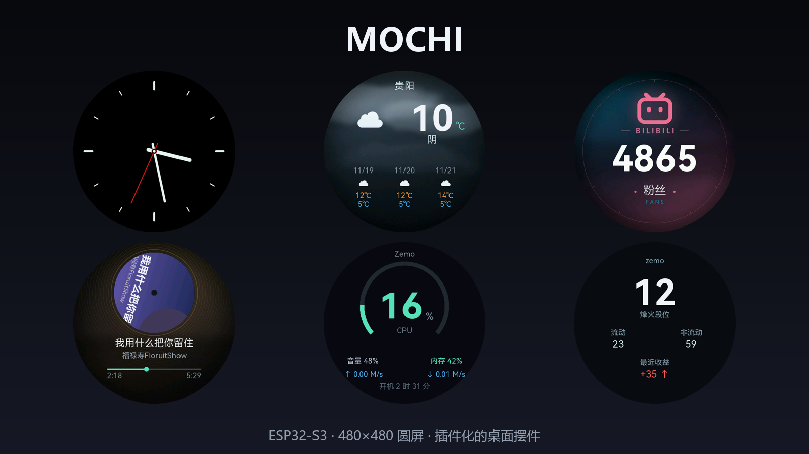
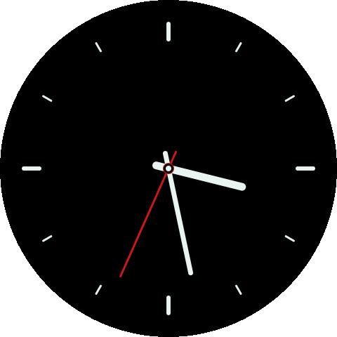
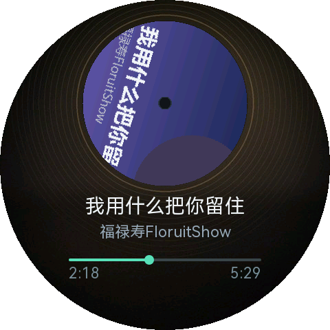
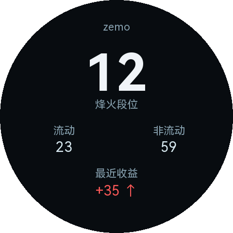

<!--
发布说明（复制到编辑器时删掉这段）：
- B站专栏：直接把全文粘进去，图片按顺序上传替换即可（图片在 docs/photos/intro/）
- 公众号：编辑器不认 Markdown 表格，把表格换成文字列表；图片需要单独上传
- 头图用 photos/intro/00-hero.png（1600×900）
-->

# 我把一块 480×480 的圆屏，做成了一个会打工的桌面摆件

大概三个月前，我在桌上放了一块圆屏开发板，本来只想写个时钟。

结果它现在会看天气、会数我 B 站粉丝、会放歌、会告诉我 CPU 快炸了，还会**因为我 DeepSeek 余额告急而趴在桌上睡觉**。

这篇文章讲讲它到底是怎么来的，以及踩过的那些很好笑的坑。



---

## 一、硬件：一块看起来像摆件的开发板

我用的板子是 **ESP32-S3-LCD-2.8C**，参数大概是这样的：

- ESP32-S3，16MB Flash + 8MB PSRAM
- **2.8 寸 480×480 圆形 IPS 屏**（这圆屏是整个项目的颜值担当）
- QMI8658 六轴 IMU（加速度 + 陀螺仪）
- PCF85063 RTC（断网也能走时）
- TF 卡槽

选圆屏的原因很朴素：**方屏像仪表盘，圆屏像摆件**。放在桌上，圆的就是比方的好看，没什么道理可讲。

---

## 二、它现在能显示什么

### 1. 时钟



最基础的一屏。两种样式，指针或者大字。断网也走得准，因为板子上有独立的 RTC 芯片。

### 2. 天气


数据来自 Open-Meteo（免费、免 API Key，这点很关键）。当前温度 + 天气现象 + 未来三天。

背景和图标是 **meteocons** 那套动画图标，会跟着天气变：晴天是暖色调，下雨是冷色调，下雪有飘雪。图标是打包成一个 `icons.bin` 放在 TF 卡里的，开机流式读取。

### 3. 哔哩哔哩粉丝数


对，就是给自己一点虚无的数字激励。每 10 分钟拉一次，涨粉会变绿，掉粉……不建议看。

### 4. 音乐副屏



这块是我最满意的部分。

电脑上跑一个小脚本，读取 Windows 的系统媒体会话（SMTC），把**正在播放的歌名、歌手、进度、专辑封面**推给板子。

封面是**转的**——真的像黑胶唱片那样慢慢转，播放时转，暂停就停住，中间还有个小轴孔。背景有 5 种可以选（黑胶、霓虹、落日、薄荷、深海）。

进度条跟着实际播放走。这里踩了个大坑，后面讲。

### 5. 电脑状态


CPU 使用率做成仪表环，颜色随负载变（绿→橙→红）。

下面一排：系统音量、内存、上传/下载速度、开机时长。数据来自 `psutil` + `pycaw`，每秒推一次。

**用来看「我的电脑为什么这么卡」非常直观。**

### 6. 桌宠（和 DeepSeek 余额）

这个最整活。


板子会去查我 DeepSeek 账户的余额，然后根据**余额变化**决定桌宠在干嘛：

| 状态 | 触发条件 | 表现 |
|---|---|---|
| 干饭 | 余额健康 | 坐在那儿吃茶泡饭 |
| 打工 | 余额在掉 | 抱着笔记本疯狂敲键盘 |
| 睡觉 | 很久没动静 | 蜷成一团睡过去 |

是的，**我花钱的速度决定了我的桌面宠物在干嘛**。

再加上一个"峰/谷"时段标签（DeepSeek 错峰优惠），和今日消耗统计。看着它从干饭打到睡觉，比我自己的账单直观多了。



---

## 三、它是插件化的

这是我一开始就决定的事：**所有屏幕都是插件，用 Lua 写，存在 TF 卡上**。

好处是：

- 改一个插件不用重刷固件
- 可以在网页后台里直接编辑
- 我写新屏幕的时候，只需要会一点点 Lua

一个最小的插件长这样：

```lua
local t = 0

function on_draw(dt)
  t = t + dt
  ui.clear(0x0b0d12)
  ui.text("Hello", 240, 200, 106, 0x5be0bd)
  ui.text(string.format("%.1f s", t), 240, 300, 29, 0x7e8c9c)
end
```

`ui.*` 提供画文字、圆、圆角矩形、弧、图标、背景、封面；`http.get` 可以联网，`store` 可以存设置，`app.get` 读配置。剩下的就是普通 Lua。

沙箱是收紧过的：没有 `io`、没有 `os`、没有 `package`，每帧指令数有上限，堆有上限。跑飞了最多是那个插件黑屏，不会把整个设备带崩。

---

## 四、网页后台

设备自带一个网页后台，手机电脑都能开：

- 开关插件、调顺序
- 改每个插件的设置（天气城市、背景、旋转开关……）
- 上传素材、字体包
- **远程截图**

对，最后这个是开发时救命的功能：板子挂在桌上，我在这边 `curl` 一下就能把它当前画面抓成 BMP，写文章配图全靠它。

```bash
curl -o shot.bmp http://192.168.1.29/api/shot.bmp
```

上面这些图，全都是这么抓下来的。

---

## 五、踩坑实录（这部分最好笑）

### 坑一：SD 卡背了半个月的锅

有段时间设备频繁出现「插件丢失」「NO ASSET」「上传失败」。

我一开始的判断是：**这块 SD 卡要挂了**。于是换了卡、格式化了三次、拔插了无数次、还让读者去检查卡座接触……最后甚至怀疑到 USB 线和电源。

真相是：**我固件里 `max_files` 设的是 4。**

而设备常驻打开的文件恰好有 5 个：桌宠视频、图标包、背景包、29px 字库、22px 字库。

第 5 个一开，句柄就满了。之后任何「打开文件」都失败——读不到 `main.lua` 就是插件丢失，写不进 `settings.json` 就是保存失败。

**卡一点问题都没有。是我自己把门锁了，然后怪门。**

改成 16 之后，一次都没再犯。这个 bug 我排查了整整两天。

### 坑二：Chrome 的媒体时间轴是冻结的

音乐进度条一开始完全不对，要么不动，要么突然往前跳。

抓了半天数据才发现：Chrome 通过 SMTC 报上来的 `position` 是**冻结的**——它只在暂停、拖动进度时才更新时间轴。你正常播放时，它一直告诉你「现在是第 0.337 秒」。

正确算法是：

```
真实进度 = position + (现在 - last_updated_time)
```

改完之后，进度条终于跟着歌走了。

### 坑三：我一个人开了六个「同步服务」

音乐服务我是用 `python music_sync.py` 跑的，调试期间反复重启。

问题是我每次 kill 的都是 PowerShell 的外壳，**Python 子进程一直活着**。

到最后一共有六个进程在同时往板子推数据，各自推不同时间点的进度。屏幕上的进度条就在 `2:26` 和 `0:00` 之间来回横跳。

我还认真地怀疑过算法、怀疑过时钟偏差、写了两版插值……

最后是 `Get-CimInstance Win32_Process` 一把梭，发现六个进程杵在那儿。

现在脚本里加了端口锁，开第二个会直接报错：

```
已经有一个 music_sync 在跑了，先把旧的关掉
```

### 坑四：43Hz 的屏幕，看着就是会闪

板子默认的面板时钟只有 12MHz，算下来刷新率 **43.1Hz**。

深色画面看不出来，一旦放彩色照片（比如天气背景），**肉眼就能看到轻微闪烁**。

我一开始怀疑是帧缓冲撕裂、是背光 PWM、是 DMA 断流，改了三版都没用。最后算了一下：43Hz 本来就低于人眼舒适阈值。把面板时钟提到 16MHz，刷新率变成 **57.5Hz**，闪就没了。

### 坑五：12 个字形缓存，导致每帧都在读 SD 卡

音乐屏待机时只有 20fps。

原因离谱：字形缓存只有 **12 个槽**，而待机那行提示文字有 **21 个不同字符**。缓存被冲垮，于是**每一帧都回 SD 卡重新读字形**。

加到 96 槽，帧率直接从 20 回到 34。

---

## 六、想复刻的话

代码全在 GitHub 上，包含固件、插件、素材打包脚本和这套文档：

```
https://github.com/z464244404/mochi
```

大概流程：

1. 买一块 ESP32-S3-LCD-2.8C
2. 装 ESP-IDF v5.5
3. `idf.py flash`
4. 开机连 WiFi，浏览器打开设备 IP
5. 上传字体包（中文字库，5.7MB + 3.4MB）
6. 想放歌就再跑一下 `tools/music_sync.py`

时钟、天气、余额、桌宠、哔哩哔哩这几个插件是**内置**的，开机会自动装到卡上，不用管。

---

## 七、最后

这个项目最开始的动机其实特别简单：**我想在桌上放一个好看的东西，而且它能显示我关心的数字。**

结果它变成了一个能跑 Lua、有插件商店（虽然只有六个）、能远程截图、还会因为我的余额而情绪低落的……小圆盘。

接下来想给它加歌词显示和音乐频谱，再给它做个"番茄钟"。

如果这篇有人看，我就继续写下去。

**毕竟它现在正在打工，我得对得起它的努力。**
