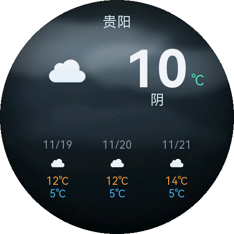
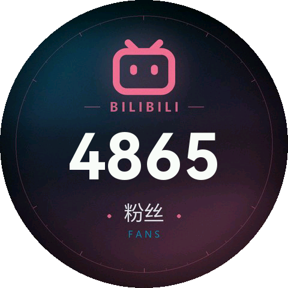
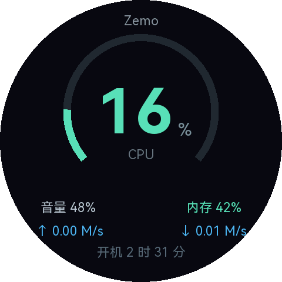
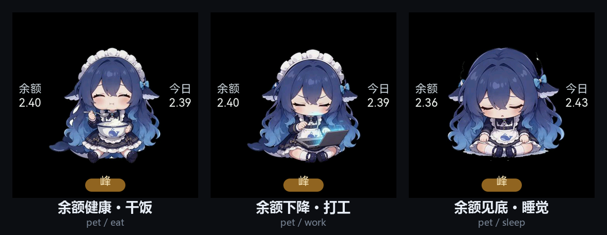
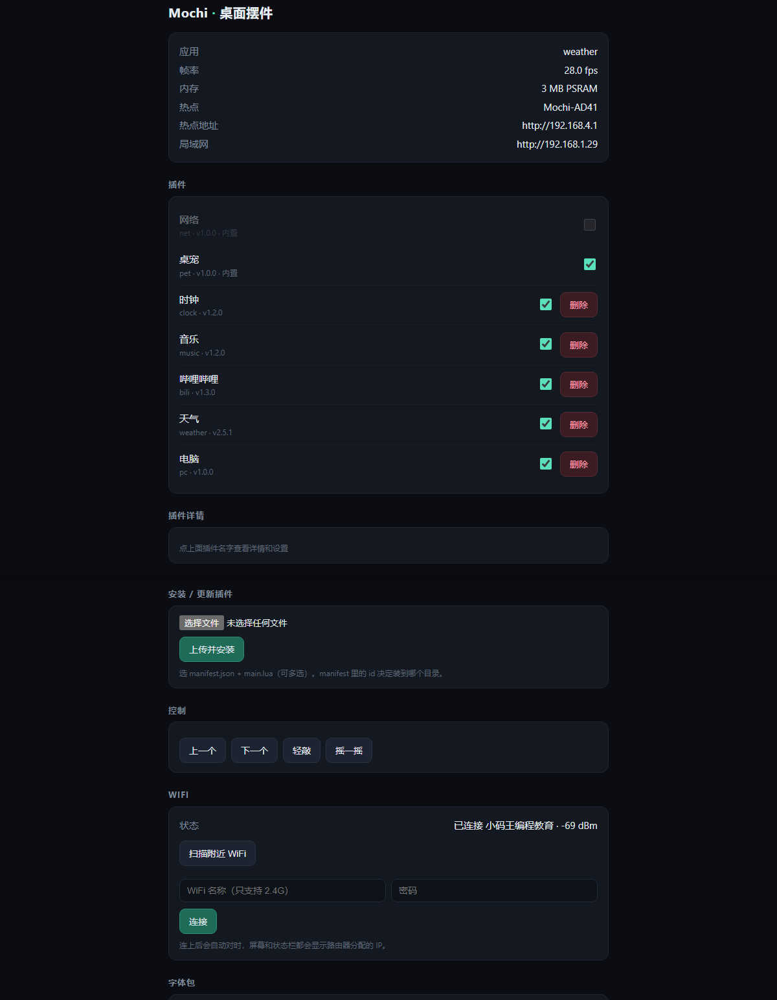

<!--
发布说明（复制到编辑器时删掉这段）：
- B站专栏：全文直接粘，图片按顺序上传替换（图片在 docs/photos/intro/）
- 公众号：不认 Markdown 表格，把表格改成文字列表；图片需单独上传
- 头图：photos/intro/00-hero.png（1600×900）
-->

# 我在桌上养了条大肥鱼，它现在会实时汇报工作状态

事情是这样的。

我在桌上养了一条**大肥鱼**。

它不吃鱼食，不用换水，唯一的爱好是盯着我的电脑看——看我 CPU 有没有跑满，看我内存有没有爆，看我今天是不是又在摸鱼。

然后它会用一副「我都看见了」的表情，把这些数字摆在我面前。


---

## 一、它到底能干什么

先说清楚，这不是一个只会显示时间的时钟。它是一块 **480×480 的圆形屏幕**，能联网、能读卡、能跑 Lua 脚本，所以它本质上是一块**可以随时长出新人格的桌面显示器**。

现在它身上有六个"人格"：

### 一、看时间（但好看）


圆屏加极简指针，放在桌上就是摆件。板子上有独立的 RTC 芯片，断网也走得准。

### 二、看天气（会动的）



当前温度 + 天气现象 + 未来三天。数据来自 Open-Meteo，免费免 Key。

真正让它好看的是那套 **meteocons 动画图标**：晴天暖色调、下雨冷色调、下雪有飘雪，背景会跟着天气一起变。

### 三、看粉丝数（自虐用）



B 站粉丝数实时刷新。涨了变绿，掉了……建议别看。

### 四、放音乐（封面是转的）


这屏是我最爱的一屏。

电脑上跑个小脚本，读 Windows 的系统媒体会话，把**歌名、歌手、进度、专辑封面**推过来。

封面真的**会像黑胶唱片一样慢慢旋转**，播放时转、暂停时停，中间还有个小轴孔。背景有五种可选：黑胶、霓虹、落日、薄荷、深海。

进度条跟着实际播放走，换歌自动切封面。

### 五、汇报"工作状态"（核心功能）



这就是标题里说的"实时显示工作状态"。

CPU 使用率做成 260° 仪表环，颜色随负载从绿→橙→红。下面一排是系统音量、内存占用、上传下载速度、开机时长。每秒刷新一次。

**用来看"我的电脑为什么这么卡"极其直观。** 卡的时候那个环直接红给你看，不用再开任务管理器。

### 六、养鱼（就是标题里那条）

这个最整活。



板子会去查我 DeepSeek 账户的余额，然后根据**余额变化**决定这条鱼在干嘛：

| 状态 | 触发条件 | 表现 |
|---|---|---|
| 干饭 | 余额健康 | 坐在那儿吃茶泡饭 |
| 打工 | 余额在掉 | 抱着笔记本疯狂敲键盘 |
| 睡觉 | 很久没动静 | 蜷成一团睡过去 |

**我花钱的速度，决定了我的桌面宠物在干嘛。**

看着它从干饭打到睡觉，比我自己的账单直观多了。

---

## 二、它是插件化的，谁都能写

这是我觉得比屏幕本身更有意思的部分。

**上面六个屏幕，全部是插件。** 用 Lua 写，放在 TF 卡里，改完不用重刷固件。

一个完整的插件大概长这样：

```lua
local t = 0

function on_draw(dt)
  t = t + dt
  ui.clear(0x0b0d12)
  ui.text("Hello", 240, 200, 106, 0x5be0bd)
  ui.text(string.format("%.1f s", t), 240, 300, 29, 0x7e8c9c)
end
```

就结束了。它会自动出现在设备的轮播里。

能用的东西大概这些：

| 能力 | 说明 |
|---|---|
| `ui.text / circle / ring / arc / line` | 想画什么画什么 |
| `ui.icon` | 播 meteocons 那套动画图标 |
| `ui.bg` | 换背景图（18 张内置） |
| `ui.cover` | 画专辑封面，还能转 |
| `http.get` | 联网拿数据（天气、B站、余额都是这么来的） |
| `store.get/set` | 存设置，网页后台能改 |
| `app.get` | 读插件自己的配置 |

所以理论上你想让它显示什么，写个插件就行：

- 股票、基金、加密货币
- 热搜榜、RSS、GitHub star
- 番茄钟、倒计时、纪念日
- 家里 NAS 的状态、下载进度
- 甚至一条会摇尾巴的像素狗

沙箱是收紧过的：没有 `io`、没有 `os`、没有 `package`，每帧指令数和堆都有上限。插件写崩了最多是那一屏黑掉，不会把设备带崩。

**目前我自己在写歌词显示和音乐频谱，欢迎卷我。**

---

## 三、网页后台，手机就能改

设备自带一个网页后台，电脑手机都能开：



- 插件开关、排序
- 每个插件的设置（天气城市、背景、旋转开关……）
- 上传素材和字体包
- 改 WiFi、传固件 OTA
- **远程截图**

连"上一屏/下一屏/轻敲/摇一摇"都有对应按钮，不用伸手去戳设备。

最后那个截图功能是开发时救命的东西：

```bash
curl -o shot.bmp http://192.168.1.29/api/shot.bmp
```

**上面这些配图，全是我这么抓下来的。**

---

## 四、踩过的坑（简单说）

篇幅关系，只挑三个最疼的：

- **SD 卡背了半个月的锅**：频繁"插件丢失""上传失败"，我以为是卡坏了，换卡、格式化、查接触……最后发现是固件里 `max_files = 4`，而常驻打开的文件正好 5 个。**卡一点问题都没有，是我自己把门锁了。**
- **Chrome 的媒体时间轴是冻结的**：它只在暂停/拖动时才更新，正常播放时永远告诉你"现在是第 0.337 秒"。正确算法是 `position + (现在 - last_updated_at)`。
- **43Hz 的屏幕看着就是会闪**：面板时钟只有 12MHz，算下来 43.1Hz。深色画面看不出来，一放彩色照片就能看出轻微闪烁。提到 16MHz（57.5Hz）就没了。

其他坑就不展开了，写出来能出本书。

---

## 五、接下来

- **外壳正在建模**：现在是裸板，正在做 3D 打印的外壳，目标是能立在桌上、背面走线不露出来。
- **视频正在准备**：会拍一个完整的搭建 + 使用演示，从烧录到放歌到养鱼。
- **插件继续写**：歌词、音乐频谱、番茄钟排队中。

代码已经开源在这里：

```
https://github.com/z464244404/mochi
```

包含固件、插件、素材打包脚本和完整文档。时钟、天气、余额、桌宠、哔哩哔哩这几个是内置的，开机会自动装到卡上。

---

## 六、最后

这个项目最初的动机特别简单：**我想在桌上放一个好看的东西，而且它能显示我关心的数字。**

结果它变成了一块能跑 Lua、能远程截图、还能因为我的余额而情绪低落的……小圆盘。

现在它正趴在桌上打工。

**我得对得起它的努力。**
