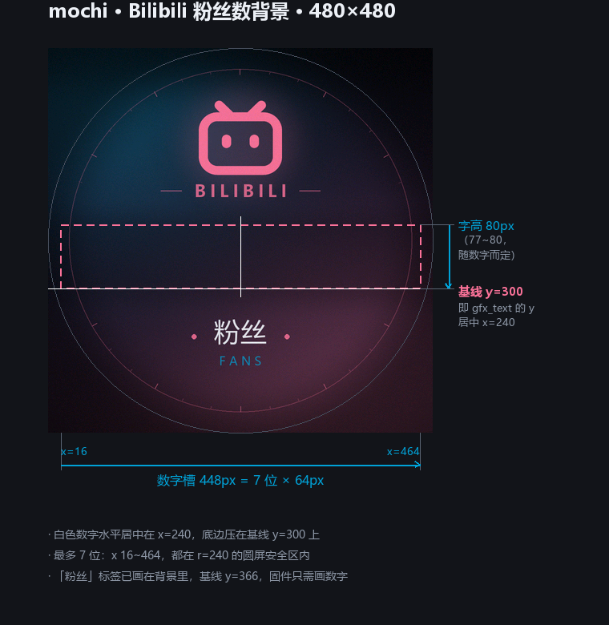
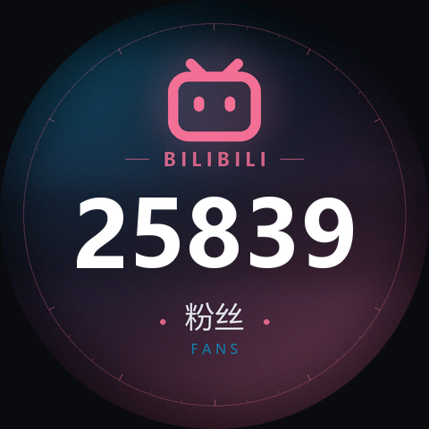

# mochi · Bilibili 粉丝数背景 · 480×480

给 `mochi` 加一屏「B 站粉丝数」。背景画好、标签烘焙进图里，固件**只需要画那串数字**。



---

## 数字放哪里、多大（核心参数）

| 项目 | 值 |
|---|---|
| 字体 | `font_digits_106`（固件内置，`fonts.c`） |
| 数字高度 | **80px**（实际 77~80，随数字而定：0/3/8 是 80，1/7 是 77） |
| 单个数字宽度 | **64px**（`adv`，定宽，数字之间不会挤） |
| 水平位置 | 居中，**中心 x = 240**（`GFX_ALIGN_CENTER`） |
| 垂直位置 | 底边压在**基线 y = 300**（即 `gfx_text()` 的 `y` 参数） |
| 数字占位 | x 16 → 464，y 220 → 300 |
| 最多几位 | **7 位**（7 × 64 = 448px） |
| 颜色 | 白色 `0xFFFFFFFF` |

`gfx_text()` 的 `y` 是**基线**不是顶边（`by = -79`），所以传 300，字形顶端落在 221 左右。

### 按位数对应的左右边界（都居中在 240）

| 位数 | x 起点 | x 终点 | 示例 |
|---|---|---|---|
| 1 | 208 | 272 | 9 |
| 2 | 176 | 304 | 42 |
| 3 | 144 | 336 | 999 |
| 4 | 112 | 368 | 1234 |
| 5 | 80 | 400 | 25839 |
| 6 | 48 | 432 | 123456 |
| 7 | 16 | 464 | 1234567 |

7 位时左右只剩 16px，但仍在圆屏 r=240 的安全区内（y=300 处圆的可视宽度是 ±232），不会被外壳裁掉。

### 版式里其它元素（已烘焙进背景，不用管）

| 元素 | 位置 | 说明 |
|---|---|---|
| **B 站 logo** | 中心 (240, 112)，**104×104** | 官方 18×18 SVG 图标，色 `#fb7299` |
| `BILIBILI` 字标 | 基线 y=186，居中 | 逐字加了字距 |
| `粉丝` 标签 | 基线 y=366，居中，33px | 已画在图上 |
| `FANS` 小字 | 基线 y=396 | 青色 |
| 外圈刻度环 | r=214 | 左右两侧 |y−260|<74 处自动留空，不压数字 |

### logo 用的是官网那个 SVG

不是手绘的，是 bilibili.com 顶栏那个 18×18 图标的 `path` 原样拿过来光栅化的：

```
<svg width="18" height="18" viewBox="0 0 18 18" fill="none">
  <path fill-rule="evenodd" d="M3.73252 2.67094C..." fill="currentColor"/>
</svg>
```

环境里没有 cairosvg，所以 `tools/bili_logo.py` 自己解析 path：只用到 `M/C/L/H/V/Z` 六个绝对指令，
三次贝塞尔拆成 24 段折线；`fill-rule=evenodd` 用「每条子路径分别填充、再逐像素异或」实现——
这样机身被挖空、眼睛又填回来，和浏览器渲染一致。4 倍超采样后缩小，边缘是干净的。

换 logo 只要改 `bili_logo.py` 顶部的 `PATH` 常量，重跑 `gen.py` 即可。
（图标是 B 站的注册商标，自己设备上玩玩没问题，对外发布要注意。）

---

## 怎么画

```c
/* 画背景（一次性，或切换时重绘） */
/* 然后只画数字：居中、基线 300、白色 */
char buf[16];
snprintf(buf, sizeof(buf), "%ld", fans);
gfx_text(&g, &font_digits_106, buf, 240, 300, GFX_ALIGN_CENTER, 0xFFFFFFFF);
```

### 字号只有一套，符号也有限

`font_digits_106` 里只有 **0-9、小数点 `.`（宽 28）、冒号 `:`（宽 30）**，**没有逗号**——
所以 `1,234,567` 这种千位分隔符画不出来（除非另加字形）。想缩短就用「12.3万」这种写法，
`.` 占 28px，不会撑爆槽位。

数字特别大时先量宽度：

```c
float w = gfx_text_width(&font_digits_106, buf);   /* 7 位 = 448 */
```

---

## 文件

```
fan-bg/
├─ png/fan-bg.png          带 BILIBILI / 粉丝 / FANS 的完整版（480×480，已 RGB565 抖动）
├─ png/fan-bg-plain.png    同款但不带任何文字，自己画标签时用
├─ jpg/                    同图 JPEG q90（每张 ~30KB）
├─ rgb565/*.bin            裸 RGB565 小端，450KB/张，不用解码器
├─ preview/                版式图、5/7/3 位模拟、plain 版模拟
└─ tools/                  gen.py（渲染）、bili_logo.py（SVG 光栅化）、preview.py（模拟+标注）
```

`plain` 版只是去掉了文字，数字槽位置完全一样。




---

## 重新生成

```powershell
cd mochi\fan-bg
python tools\gen.py          # 两张背景 + jpg + rgb565
python tools\preview.py      # 版式图 + 数字模拟
```

改配色/版式只要动 `tools/gen.py` 顶部的常量：

```python
NUM_BASELINE = 300   # 数字基线
NUM_CENTER_X = 240
DIGIT_ADV = 64
MAX_DIGITS = 7
```

改完记得同步 `tools/preview.py` 里的同名列，再重跑两张图。

---

## 两个提醒

- 背景是**深色**的，数字槽那一带的亮度我量过：白色数字对比度 **15:1 以上**，最亮的一个像素也有 10.5:1，
  比 WCAG 的 4.5 高很多，白天看也清楚。代价是换浅色底就得把数字改深色，别直接沿用白字。
- 粉丝数刷新时别整屏重绘背景（480×480 的 blit 每帧 450KB），状态栏那种滚数字只要在数字区
  重画一条 448×84 的带子再叠新数字就行。
