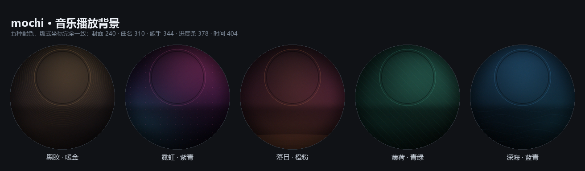
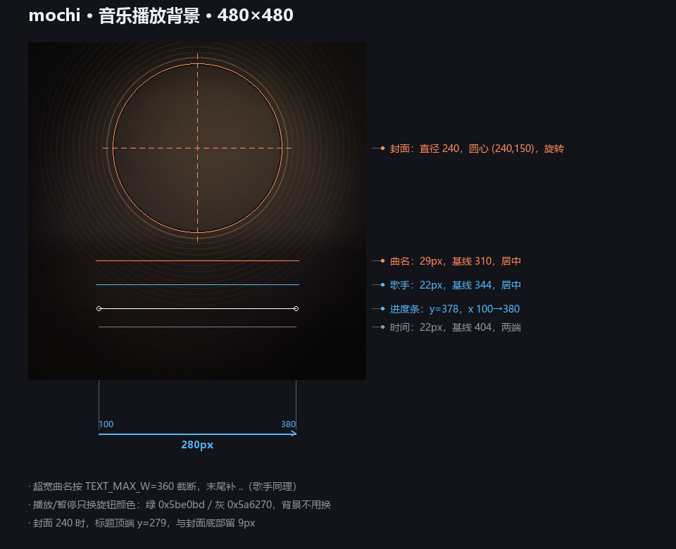

# mochi · 音乐播放插件背景 · 480×480

五种配色，**版式坐标完全一致**——换背景不用改任何绘制代码。





---

## 版式参数（和 `tools/layout.py` 一字不差）

| 元素 | 位置 | 尺寸 / 字号 | 备注 |
|---|---|---|---|
| **专辑封面** | 圆心 **(240, 150)** | 直径 **240**（r=120） | 旋转；背景里已画好 r=129 的凹槽环 |
| **曲名** | 居中 x=240，基线 **y=310** | **29px**（`font_ui_29`，字高 31） | 超宽截断加 `..` |
| **歌手** | 居中 x=240，基线 **y=344** | **22px** | 同上 |
| **进度条** | x **100 → 380**，**y=378** | 轨高 **4**（圆角 2），旋钮 **r=7** | 播放绿 / 暂停灰 |
| **时间** | 基线 **y=404** | **22px** | 左 `left@100`，右 `right@380` |

垂直关系：封面底边 270 → 曲名顶端 279（留 9px）→ 歌手 344 → 进度条 378 → 时间 404。
整块内容在 r=240 的圆内，7 位时间（如 `1:23:45`）也不会压到弧边。

### 进度条颜色

| 状态 | 旋钮 | 已播段 | 未播段 |
|---|---|---|---|
| 播放 | `0x5be0bd` | 同旋钮色 | `0x3e444e` |
| 暂停 | `0x5a6270` | 同旋钮色 | `0x3e444e` |

背景**不画进度条**（那段只做压暗），轨、旋钮、两端时间全由固件画，所以切换播放状态不用换图。

### 截断规则

`TEXT_MAX_W = 360`（左右各留 60px，圆屏在 y≈310 处的可视半宽是 ±237，留足余量）。

- 曲名逐字删到 ≤360px，再补 `..`
- 歌手同理，一般不会超
- 建议在固件里先量 `gfx_text_width()`，别让长名字把进度条挤下去

---

## 五种配色

| 文件 | 风格 | 装饰 | 适合 |
|---|---|---|---|
| `vinyl` | 黑胶 · 暖金 | 同心唱片沟槽 | 爵士 / 老歌 / 播客 |
| `neon` | 霓虹 · 紫青 | 点阵网格 + 双向光晕 | 电子 / 夜店 |
| `sunset` | 落日 · 橙粉 | 下沿暖雾带 | 民谣 / 流行 |
| `mint` | 薄荷 · 青绿 | 斜向细线 | 轻音乐 / 白噪音 |
| `ocean` | 深海 · 蓝青 | 横向波纹 | 古典 / 助眠 |

---

## 文件

```
music-bg/
├─ png/            5 张 480×480，已按 RGB565 抖动量化
├─ jpg/            同图 JPEG q90（每张 ~30KB）
├─ rgb565/         裸 RGB565 小端，450KB/张
├─ preview/        overview / guide / 5 张模拟 / 暂停 / 长标题截断
└─ tools/          layout.py（坐标）、gen.py（背景）、preview.py（模拟+标注）
```

```powershell
cd mochi\music-bg
python tools\gen.py            # 五张背景 + jpg + rgb565
python tools\preview.py        # 总览、版式图、模拟
```

改版式只动 `tools/layout.py`，两个脚本都从这里取坐标，不会画歪。

---

## 两个字体上的坑（比背景更卡）

背景已经画好了，但落到固件上会遇到两件事：

**1. 22px 没有中文字库。** `font_num_22` 只有 16 个字形（数字和符号），没有汉字；
`font_ui_29` 字高 31，是唯一带中文的字体。所以歌手那行按 22px 画中文会漏字。
要么用 `tools/gen_font.py` 另生成一个 22px 的中文子集，要么把歌手改成 29px 并把基线从 344 挪到 342。

**2. `font_ui_29` 只有 221 个字形（约 138 个汉字）。** 曲名是任意歌曲名，绝大多数会缺字。
按每字约 580 字节算：收 3500 常用汉字大约 2MB——16MB flash 放得下，但要扩 assets 分区。

要的话我可以直接跑 `gen_font.py`，生成「3500 常用字 @29px + 一个 22px 子集」两套字体，
顺手把 `<sd 卡>/fonts.bin` 的加载路径也接上。
