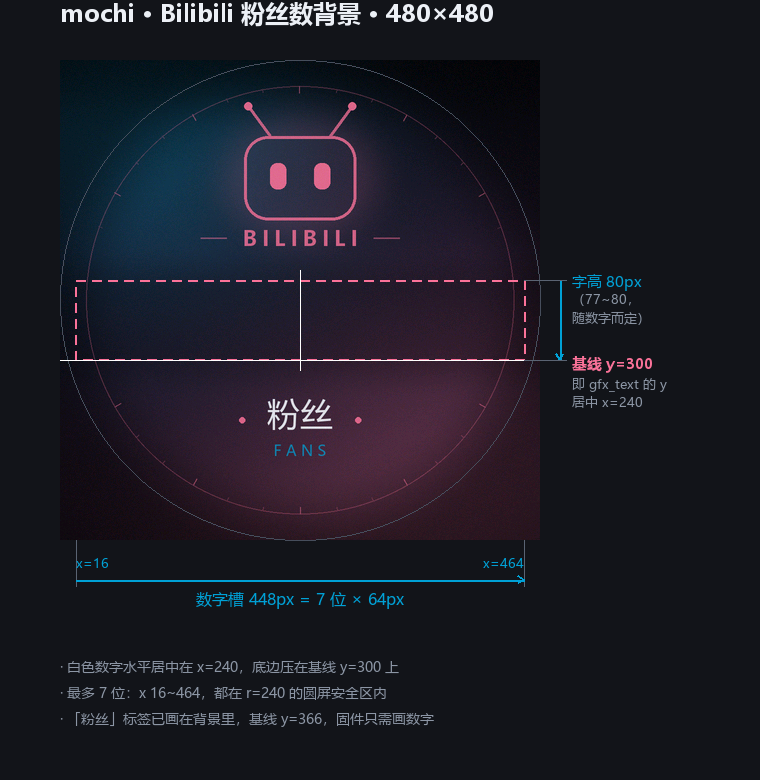

# 哔哩哔哩粉丝数 · Mochi 插件

给 [Mochi](https://github.com/z464244404/mochi) 桌面摆件的 B 站粉丝数屏。

## 特性

- 数据源：B 站官方公开接口 `api.bilibili.com/x/relation/stat`，**免登录、免 key**
- 背景是画好的 480×480 图（logo、`BILIBILI` 字标、`粉丝`/`FANS` 标签都烘焙在图上），
  插件只把数字画进留好的槽位
- 5 分钟刷新，数据缓存到卡上
- 断网/未填 UID 时显示 `NO UID` / `NO NET` / `ERR <code>`

## 安装

1. 网页后台「安装 / 更新插件」→ 选中 `manifest.json` + `main.lua` → 上传
2. 插件详情里填 **UID**（个人空间地址里的那串数字，例如 `https://space.bilibili.com/373992388` → `373992388`）
3. 摇到这一屏

背景图 `bili` 打在固件的素材包 `bg.bin` 里，装了固件就有；没有时会退化成纯色底。

## 版式

数字用内置的 `font_digits_106`：字高 80px、单个数字宽 64px、最多 7 位。

| 项目 | 值 |
|---|---|
| 数字中心 | x=240, y=260（`ui.text` 的 y 是竖直中心） |
| 对应基线 | 299 ≈ 300 |
| 数字墨迹范围 | y 220~300，x 16~464（7 位时） |
| 颜色 | 白色 |

## 说明

- 只支持查**公开的**粉丝数/关注数（不需要登录）
- 接口无官方稳定性承诺，但已稳定多年
- 粉丝数直接显示原始整数（4865），超过 7 位会超出槽位
