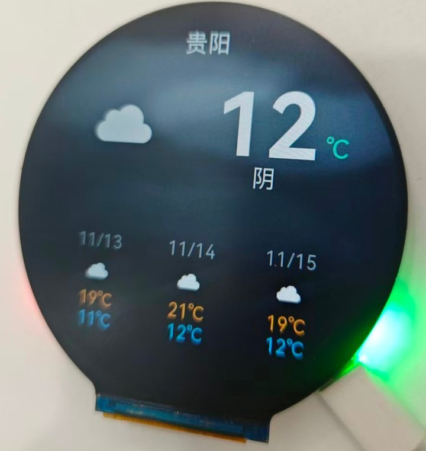

# 天气 · Mochi 插件

给 [Mochi](https://github.com/z464244404/mochi) 桌面摆件的天气屏：实时温度 + 未来三天。

## 特性

- 数据源 **Open-Meteo**，免费、免注册、无需 API key
- 图标是 [Meteocons](https://meteocons.com/) 的原始动画帧（存在卡上 `icons.bin`）
- 背景随天气变化（`bg.bin` 里 16 张背景）
- 中文天气词（晴/多云/阴/小雨/中雨/大雨/暴雨/雷阵雨/雪/雾）
- 每 5 分钟刷新，数据缓存到卡上，断网也不报错
- 未来三天横排三列：日期 / 图标 / 高温（橙）/ 低温（蓝）

## 安装

网页后台「安装 / 更新插件」→ 选中 `manifest.json` + `main.lua` → 上传。

天气图标和背景在固件的素材包里（`icons.bin` / `bg.bin`），不用单独装。

## 设置

| 项 | 说明 | 默认 |
|---|---|---|
| 地名 | 显示在顶部 | 深圳 |
| 纬度 / 经度 | Open-Meteo 查询用 | 22.54 / 114.06 |
| 单位 | `c` 摄氏 / `f` 华氏 | `c` |

## 换城市

只改「地名」不会换数据源，**纬度和经度也要改**。查坐标：在 [openstreetmap.org](https://www.openstreetmap.org/) 搜城市，右键「显示地址」就能看到。

## 说明

- 接口：`https://api.open-meteo.com/v1/forecast?...&forecast_days=4`
- 只支持 2.4G WiFi
- 缺字会显示空白，装 `fontpack.bin` 后任意中文可显示
