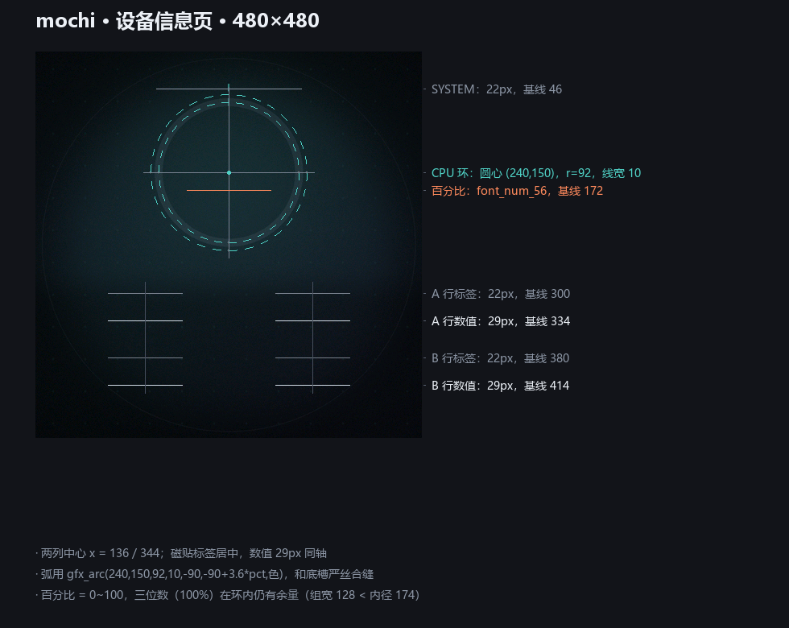
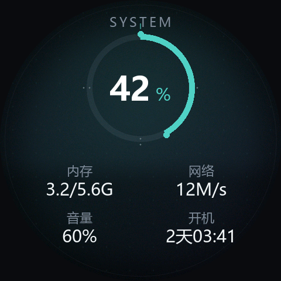
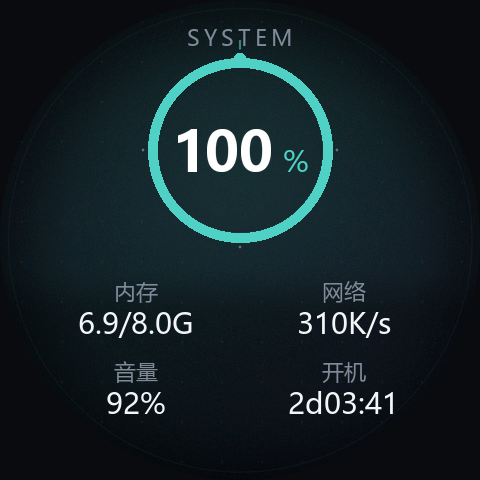

# mochi · 设备信息页背景 · 480×480

五个数据：**CPU 使用率**（圆环 + 百分比）、**内存**、**网络**、**系统音量**、**开机时长**。



## 为什么这样排

- 圆屏的四个角是废的，能用的是一条中间宽、上下窄的竖条。**上半圆**正好放一个环，既填满了圆顶的宽度，又让"百分比"天然有个刻度尺。
- 剩下四个数都是**两段式**（标签 + 数值），2×2 磁贴最省空间，而且四个格子对齐后一眼能扫。
- 环里的百分比是**唯一的大字**，其余全部压到 29px 以下，层级清楚。
- 所有文字都在 **r=220 以内**，不会被外壳裁到。

---

## 具体位置（和 `tools/layout.py` 一致）

| 元素 | 位置 | 字号 / 尺寸 | 颜色 |
|---|---|---|---|
| 顶部标题 `SYSTEM` | 基线 **46**，居中 x=240 | **22px**，字距 4 | `0x7f8b99` |
| **CPU 环** | 圆心 **(240, 150)** | **r=92**（中线），线宽 **10** | 底槽 `0x1b222c`，弧 `0x4fd1c5` |
| **百分比数字** | 环内居中，基线 **172** | `font_num_56`（字高 43，每位宽 34） | `0xf2f6f8` |
| 百分号 `%` | 数字右侧，间隔 10 | **29px** | `0x4fd1c5` |
| A 行标签（内存 / 网络） | 基线 **300**，x = **136 / 344** | **22px** | `0x7f8b99` |
| A 行数值 | 基线 **334**，同上 x | **29px** | `0xf2f6f8` |
| B 行标签（音量 / 开机） | 基线 **380**，x = **136 / 344** | **22px** | `0x7f8b99` |
| B 行数值 | 基线 **414**，同上 x | **29px** | `0xf2f6f8` |

### 弧怎么画

`gfx_arc()` 的 `r` 是**中线半径**，和背景里烘焙的底槽完全对齐，直接叠：

```c
float a1 = -90.0f + 3.6f * pct;                  /* pct = 0..100，-90 是 12 点 */
gfx_arc(&g, 240, 150, 92, 10, -90, a1, 0xFF4FD1C5);
```

- `pct < 0.5` 时不要画弧（圆头会变成一个点，看着像噪点）
- `pct > 99.5` 直接画整圆，否则首尾两个圆头会在 12 点叠出一个小鼓包

---

## 数值格式：B 行只有 122px 可用

y=414 处圆的可视宽度是 x 74→405，格子中心在 344，所以**右下角那个值最宽只能到约 122px**（留 10px 余量）。

| 项 | 推荐格式 | 宽度 | 说明 |
|---|---|---|---|
| 内存 | `3.2/5.6G` | ~112px ✓ | 用 `/` 分隔已用/总量 |
| 网络 | `12M/s` | ~80px ✓ | 上行下行轮播，别同屏两个 |
| 音量 | `60%` | ~48px ✓ | |
| 开机 | `2d03:41` | ~112px ✓ | **别用「天」**：`2天03:41` 约 131px，会顶到圆边 |

想用中文「天」，就把这一格的值降到 22px，或者把 B 行整体上移到 408。

---

## 字体：三个标签暂时画不出来

`font_ui_29` 现在只有 221 个字形，我逐个查了：

| 字 | 状态 |
|---|---|
| 网络 | ✅ 有（"等待网络"里带） |
| 内存、音量、开机 | ❌ 没有 |
| 使用率、频率 | ❌ 没有 |

所以有两个选择：

**A. 先用 ASCII**（现在就能跑，坐标完全不变）

`SYSTEM` / `MEM` / `NET` / `VOL` / `UP` —— 见 `preview/03-mock-ascii.png`。`font_ui_29` 的 ASCII 全在。

**B. 扩字库**（推荐，一次到位）

在 `tools/gen_font.py` 的 `CJK` 串里补上：

```text
使用率频率内存音量开机设备信息剩余已上传下载速度信号强亮电池温压进程线空闲
```

再加一条 `("font_ui_22", REG, 22, ASCII + 同样的 CJK)`，重新生成 `fonts.c`。
22px 一档大约 200 字 ≈ 60KB，占用很小。

---

## 文件

```
sysinfo-bg/
├─ png/sysinfo.png     480×480，已 RGB565 抖动
├─ jpg/sysinfo.jpg     约 30KB
├─ rgb565/sysinfo.bin  450KB 裸数据
├─ preview/            标注图 + 正常/100%/ASCII 三种模拟
└─ tools/              layout.py（坐标）、gen.py（背景）、preview.py（模拟+标注）
```

```powershell
cd mochi\sysinfo-bg
python tools\gen.py
python tools\preview.py
```

背景里烘焙了两样东西：**环的底槽**（r=92、宽 10）和 **12 点起始刻度 + 25%/50%/75% 三个分位点**。
所以固件只要画弧和文字，不用画底槽。




