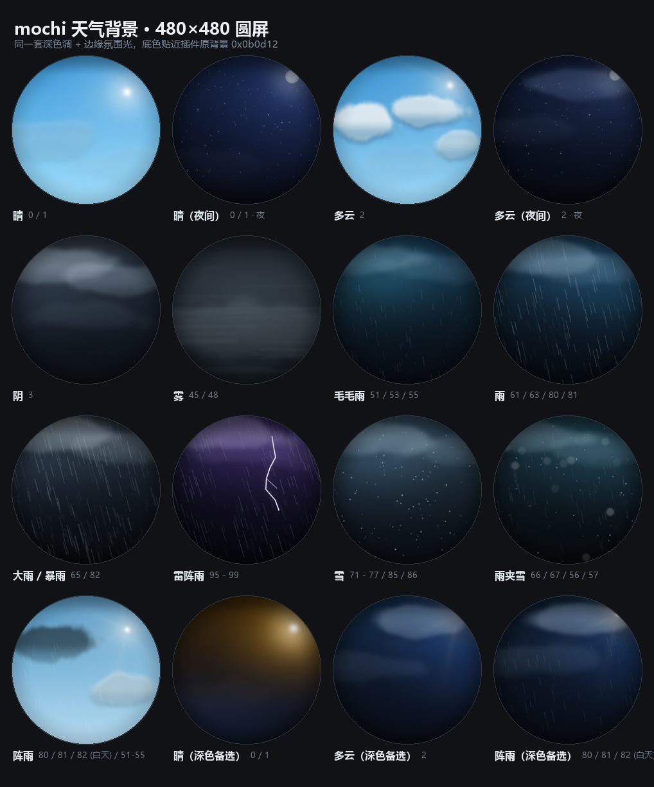
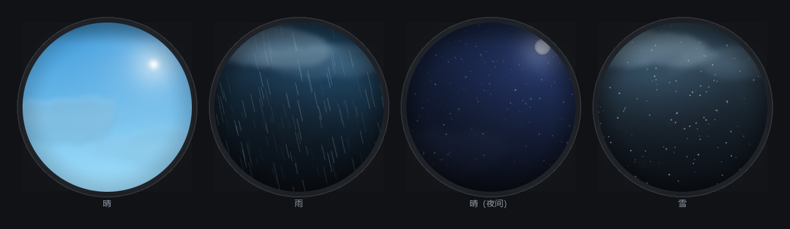

# mochi 天气背景 · 480×480 圆屏

给 `mochi` 的天气屏配的一套背景图：**16 张 480×480**，按 meteocons 图标的天气名一一对应，
配色也是从图标里取的（琥珀 `#f7b32b`、宝蓝 `#2e6be6`、云白 `#dfebf7`），和图标是同一套语言。

白天三张按你的意见改成了**明亮天蓝**；夜里、阴雨雪雾保持深色调（亮底会把白字压没）。



---

## 目录

```
weather-bg/
├─ png/           16 张 480×480 PNG，已按 RGB565 抖动量化（看到的就是屏上效果）
├─ jpg/           同图 JPEG q88，平均 24KB/张 —— 上卡、走 OTA 都更省
├─ rgb565/        裸 RGB565 小端 .bin，450KB/张，不用解码器，直接 memcpy 上屏
├─ preview/       总览 / 实机模拟 / 圆屏外观
├─ tools/         gen.py（渲染）recipes.py（配色表）preview.py（预览）check.py（对比度）
├─ index.json     文件名 → 中文、WMO、该用哪套文字配色
└─ contrast.md    每张图在文字区的实测对比度
```

---

## 和插件里的 `icon_for()` 一一对应

文件名就是图标名，查表不用转换：

| 背景文件 | 天气 | WMO | 文字配色 |
|---|---|---|---|
| `clear-day` | 晴 | 0 / 1 | **亮色（浅底深字）** |
| `clear-night` | 晴（夜间） | 0 / 1 · 夜 | 深色（原配色） |
| `partly-cloudy-day` | 多云 | 2 | **亮色** |
| `partly-cloudy-night` | 多云（夜间） | 2 · 夜 | 深色 |
| `cloudy` | 阴 | 3 | 深色 |
| `fog` | 雾 | 45 / 48 | 深色 |
| `drizzle` | 毛毛雨 | 51 / 53 / 55 | 深色 |
| `rain` | 雨 | 61 / 63 / 80 / 81 | 深色 |
| `overcast-rain` | 大雨 / 暴雨 | 65 / 82 | 深色 |
| `thunderstorms-rain` | 雷阵雨 | 95 - 99 | 深色 |
| `snow` | 雪 | 71 - 77 / 85 / 86 | 深色 |
| `sleet` | 雨夹雪 | 66 / 67 / 56 / 57 | 深色 |
| `partly-cloudy-day-rain` | 阵雨 | 80 / 81 / 82（白天） | **亮色** |

另外三张是**深色备选**（构图不变，只是换成夜间友好配色），不想动文字颜色时直接换过去：

`clear-day-dark`、`partly-cloudy-day-dark`、`partly-cloudy-day-rain-dark`



---

## 亮蓝天这次要动一下文字颜色

亮底 + 原来的浅灰蓝字，`℃`、日期、低温基本看不见（实测最差 1.0~1.2，等于没有对比）。
把白天那三张的文字换深色就正常了（实测最差 4.3~4.8）：

| 元素 | 原配色 | 亮底改 | 说明 |
|---|---|---|---|
| 城市名 | `0xa8b4c0` | `0x06233a` | |
| 温度 | `0xf4f7f8` | `0x041420` | |
| 单位 | `0x5be0bd` | `0x0a5c4a` | 薄荷绿压深 |
| 天气词 | `0x7e8a99` | `0x123a56` | |
| 日期 | `0x6b7785` | `0x123a56` | |
| 高温 | `0xff9f43` | `0x7a3c04` | 琥珀压深 |
| 低温 | `0x54b8ff` | `0x0a3c66` | 蓝压深 |

`WEATHER_LUA` 里已经是分元素写色的，加一处判断就够：

```lua
-- 白天亮蓝背景用深色字，其余用原配色
local LIGHT_BG = (cur.code == 0 or cur.code == 1 or cur.code == 2
                  or cur.code == 80 or cur.code == 81) and not night
local C_TEMP = LIGHT_BG and 0x041420 or 0xf4f7f8
local C_CITY = LIGHT_BG and 0x06233a or 0xa8b4c0
...
```

不想改代码就整套用 `*-dark` 那三张。

---

## 怎么放到设备上

**图片本身**：卡根目录建个 `wxbg/`，把要用的 `.jpg` 丢进去，`/sdcard/wxbg/rain.jpg` 这样读。
`.jpg` 走固件里已有的 `esp_new_jpeg`；`.bin` 是 RGB565 小端裸数据（无文件头，逐行从左到右），
不需要解码器，`memcpy` 进 framebuffer 即可，代价是每张占 450KB。

**注意**：现在插件的 `ui.*` 只有矢量的 `clear / rect / circle / ring / line / text / icon`，
没有画图片的接口。要让背景图真正上屏，还得在固件里补一个 blit，最省事的两条路：

- **A**：进天气屏时把背景解码进一块 480×480 RGB565 buffer（PSRAM 450KB，板上还剩 ~5.6MB），
  每帧 `memcpy` 到当前 framebuffer 再画文字 —— 每帧多 450KB 拷贝，参考现有 450KB/帧的带宽，掉帧有限。
- **B**：只在天气码变化时重绘背景层，其余帧只画文字。省带宽，但要给 gfx 加一个「背景层」概念。

如果天气屏最后不是这套 ESP-IDF 固件（TFT_eSPI / LVGL 等），直接拿 `png/` 或 `jpg/` 就行。

---

## 重新生成 / 改配色

```powershell
cd mochi\weather-bg
python tools\gen.py                 # 重渲染全部（png / jpg / rgb565 / index.json）
python tools\gen.py --only rain     # 只做一张
python tools\preview.py             # 总览 + 实机模拟 + 圆屏外观
python tools\check.py               # 文字区对比度 → contrast.md
```

想调色只动 `tools/recipes.py`：每张图一组 `base`（竖渐变）、`lights`（环境光）、
`clouds`（云）、`motifs`（雨/雪/星/月/太阳/闪电/雾）。`gen.py` 里有安全区逻辑：

- 城市名（y46）、大图标（120,150）、温度（318,148）、底部三列预报（y250-368）不放大反差；
- 圆屏安全半径 240，边缘 0.42 的柔暗角，正好压在外壳下面；
- 输出前按 **RGB565 量化 + 1 LSB 抖动**，避免 5-6-5 屏上的色带。

---

## 已知取舍

- `fog` 是整套里唯一偏亮的一张，日期那一档灰字（`0x6b7785`）实测对比度约 1.9 —— 雾天可接受，
  真在意就把 `WEATHER_LUA` 里日期的颜色改成 `0x2c3a44`。
- 全部是静态图。要做成会动的（雨丝位移、雪飘、云飘），在 `gen.py` 里按帧偏移重渲染成序列就行，
  但 480×480 的序列很吃卡空间：参考桌宠 53 帧是 1.14MB，天气做个 12 帧循环大概 300KB/种。
- PNG 里已经写入了抖动，别再二次压缩成低质量 JPEG，否则暗部会出色块。
